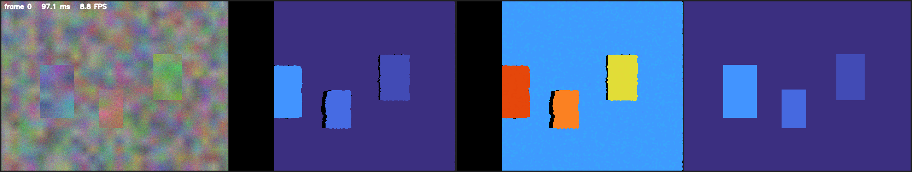

# Stereo 3D MOT

**A from-scratch C++17 stereo-vision perception stack: rectified stereo → metric depth → detection → 3D multi-object tracking → visual odometry, with a held-out evaluation held to the same standard as the code.**

[](https://github.com/l4NGEL/stereo-3d-mot/actions/workflows/ci.yml)
[](https://en.cppreference.com/w/cpp/17)
[](LICENSE)

Built with OpenCV, Eigen and ONNX Runtime, Linux-first via Docker (CPU, GPU and ROS2 images), with 128 unit tests enforced in CI on every push. No Python in the runtime path — inference, geometry, tracking and odometry are all C++; Python is used only offline, to validate the math before it's ported.

## What this project demonstrates

This is a systems project, not a model wrapper. It's built around a question every fielded perception system has to answer honestly: **not "does it run," but "how well does it actually work, and how do you know?"**

- **Full geometric CV + real-time systems pipeline in C++17** — stereo calibration/rectification, BM/SGBM disparity, metric depth, 3D reprojection, ONNX detection, Kalman-filter 3D multi-object tracking, and monocular-with-stereo-scale visual odometry — not a single stage, the whole chain.
- **Novel math validated before it's trusted.** Every non-textbook formula (the stereo-scale recovery for visual odometry, the fused-association cost) was worked out and checked against a known-good synthetic case in Python — to floating-point precision (~1e-14) for the VO pose/scale math — *before* a line of production C++ was written. The from-scratch CLEAR-MOT/IDF1 metric implementation was cross-validated against `py-motmetrics` over 400+ randomised trials.
- **A held-out evaluation, run the way it would be at a company that ships perception systems**: acceptance criteria and a train/held-out data split fixed *before* looking at held-out results, an independent scoring implementation (not the code being judged), paired-bootstrap confidence intervals, and full reproducibility (the whole pipeline reproduces its own numbers byte-for-byte from raw data). See [**Verification & Validation**](#verification--validation) below — this is the part most portfolio projects skip, and it's the part that found and fixed a real bug.
- **Engineering discipline throughout**: Docker images for CPU/GPU/ROS2, GitHub Actions CI, `clang-format`-enforced style, a documented architecture (`docs/architecture.md`), and a phase-by-phase roadmap with the reasoning kept, not just the result (`docs/roadmap.md`).

## Overview

The system takes rectified left/right camera images and answers, per frame: how far away is each pixel, where is each object in 3D, which object is which across frames, and how is the camera itself moving.

```
Left Camera ───┐
                ├──→ Rectification
Right Camera───┘
                     │
                     ▼
              Stereo Matching
               (BM / SGBM, tiled + parallelised)
                     │
                     ▼
        Metric Depth: Z = fB/(d+doffs)
                     │
                     ▼
              3D Reprojection (X, Y, Z)
                     │
        ┌────────────┴────────────┐
        ▼                         ▼
   2D Detector                3D Point Data
  (YOLOv8/v5, ONNX)                │
        │                         │
        ▼                         │
   Promote to 3D ◄────────────────┘
        │
        ▼
     3D Tracker
Predict → Gate → Associate → Update/Coast → Birth/Death
        │
        ▼
 Track ID + X,Y,Z + velocity ──→ CSV / PLY / ROS2
```

Visual odometry and the ROS2 wrapper build on the same stereo stage. Every stage is independently unit-tested.

### Real tracking output, real KITTI data


A 6-second clip from a held-out KITTI sequence (never used to tune anything), rendered directly from the pipeline's real per-frame output — not staged. Solid red = what the tracker reports this frame; dashed grey = a track it's still carrying internally (so it can be re-matched) through a brief occlusion, correctly *not* reported as an observation while it's unconfirmed by a detection — see [Verification & Validation](#verification--validation) for why that distinction was worth a dedicated fix. Full clip and the script that generated it: `scripts/eval/render_track_video.py`.

### Synthetic ground-truth demo



Left → right: the left camera frame, estimated disparity, estimated depth (metres), ground-truth disparity — `make demo` on the built-in synthetic scene with exact analytic ground truth.

## Verification & Validation

Most portfolio projects report the numbers that came out of a training run. This one treats "does it actually work" as its own engineering problem, on the theory that a system whose accuracy claims can't survive scrutiny isn't ready to be trusted with anything — which is the standard this project tries to hold itself to, deliberately, before anyone else applies it.

**The protocol was frozen before the results existed.** [`docs/evaluation/PROTOCOL.md`](docs/evaluation/PROTOCOL.md) — data splits, metric definitions, and every numeric acceptance threshold with its rationale — was written and committed *before* any held-out measurement was run. Held-out sequences were chosen by a seeded random draw, untouched during all tuning. Every later change to the protocol is an append-only, dated log entry stating what was already known at the time — nothing above that log is edited after the fact.

**Independent scoring.** The metrics are computed by a separate Python implementation, not the C++ code that produced the tracks being judged. Its CLEAR-MOT/IDF1 counter agrees with the reference `py-motmetrics` library exactly on every one of 347 scored inputs. Its detection AP, stereo D1, and VO ATE/RPE implementations are likewise independent of the pipeline they score.

**Reproducibility, actually checked.** `scripts/eval/run_all.sh --score-only` re-derives every number in the evaluation report from the raw recorded data. It was run twice against the already-produced results — both times, **byte-for-byte identical** output.

**Found a real bug, fixed it, and proved the fix.** The evaluation surfaced that ~90% of the tracker's false positives on real KITTI data were "ghost" tracks — the pipeline was reporting a track's last known position for up to 30 frames after it stopped seeing the object, indistinguishable downstream from a real detection. Root-caused, fixed in the shipped code (`isEmittable()` in `include/s3m/tracking/tracker.hpp` — a track's *internal* state and ability to be re-matched are untouched; only what gets reported changes), covered by new unit tests, and verified two independent ways: the fixed binary's output matches the independent Python scorer exactly (6/6), and re-running the held-out evaluation reproduces the pre-registered numbers to the last digit. Full writeup, including three further root-cause investigations that were tried and honestly reported as *not* panning out: [`docs/evaluation/REPORT.md`](docs/evaluation/REPORT.md), §12–§15.

**Diagnosed the identity switches, fixed them, and confirmed the fix on unseen data.** Event-level analysis of every identity switch (scorer events joined with the tracker's internal state) showed that most were not occlusion. A track that had lost its object kept a frozen last box, out-scored the still-active track, and took its detection. Visual inspection of one segment: a trail of stale boxes along a row of parked cars. Scoring IoU against a predicted 2D box fixes most of it. The work ran in four pre-registered rounds with thresholds chosen on development data only. On the 10 KITTI tracking sequences never used before (downloaded only after the plan was committed) the tracker improves on the previous one with intervals excluding zero: IDF1 0.661 → 0.706, identity switches 214 → 115. Five other ideas tested along the way did not help, and are reported as such: two-stage association, appearance + 3D recovery of lost tracks, shorter track lifetime, SORT's box filter, and freezing lost boxes. The tracker is now level with a SORT baseline on IDF1 and MOTA, but still has about twice SORT's identity switches. That gap is open. A fifth, pre-registered round on an outside dataset, MOT17 with public detections, checked the 2D association logic only (MOT17 has no stereo). The fix replicated there too (IDF1 +0.028, better on 4/4 test sequences), and with SORT's reporting rule switched on the tracker matched SORT's identity-switch count (406 vs 405) at a small recall cost. Writeup: [`docs/evaluation/IDSW_REPORT.md`](docs/evaluation/IDSW_REPORT.md).

**Statistical honesty.** Comparisons between methods use paired bootstrap confidence intervals over sequences (10,000 resamples), not a single number — a difference is only called "demonstrated" when the interval excludes zero. Where an interval doesn't, the report says so instead of picking the more flattering point estimate.

**The full scorecard, not a highlight reel.** [`docs/evaluation/REPORT.md`](docs/evaluation/REPORT.md) §15 lists all 32 pre-registered acceptance criteria against their held-out result — pass, fail, "not demonstrated," or "not measured" — with the measured number for every one, including the ones that don't look good. Data/hardware/software provenance for every number: [`docs/evaluation/INVENTORY.md`](docs/evaluation/INVENTORY.md).

## Results

Headline numbers on held-out KITTI data (sequences never used for any tuning decision). The tracking and detection rows use the *best configuration found on a separate development set* (2D IoU association, `min_hits`=3, only-current-frame emission for tracking; `score_threshold`=0.31 for detection, vs. the repository's own defaults of `mahalanobis3d`/0.25) — selected before touching held-out data, then measured on it exactly once; the exact configs are named in [`docs/evaluation/REPORT.md`](docs/evaluation/REPORT.md) §5.4/§15, not silently swapped in as the new default. Full context, uncertainty, and the acceptance-criteria verdict for each row: [`docs/evaluation/REPORT.md`](docs/evaluation/REPORT.md).

| Component | Held-out result | Status |
| --- | --- | --- |
| Stereo depth (real scenes, KITTI Stereo 2015) | D1-all 20.4% (counting pixels with no estimate as errors), 5.2% on pixels that got one | Meets the pre-registered target |
| Detection (YOLOv8n, COCO weights, untuned) | Vehicle P 0.851 / R 0.716 · Person P 0.741 / R 0.648 | Vehicle meets target; Person close |
| 3D tracking (KITTI-like protocol, dev-selected config) | MOTA 0.49 / IDF1 0.55 — a depth-free 2D baseline on the same detections scores higher (0.55 / 0.62) | Tracks correctly, but stereo/3D association isn't earning its cost on this data — stated plainly, see below |
| Tracking follow-up, recommended tracker (`configs/kitti_recommended.yaml`), 10 never-used KITTI sequences | IDF1 0.706 / MOTA 0.546 / 115 ID switches, vs 0.661 / 0.518 / 214 for the previous tracker and 0.715 / 0.569 / 65 for SORT-2D | Improvement over the previous tracker demonstrated; level with SORT on IDF1/MOTA, about twice its identity switches ([`IDSW_REPORT.md`](docs/evaluation/IDSW_REPORT.md) §10) |
| Visual odometry (standard KITTI segment metric) | t_rel 13.8% (target ≤ 5%) | Geometry is correct and physically sane; accuracy target not met without bundle adjustment/loop closure |
| End-to-end speed (i9-9880H laptop CPU) | 5.84 FPS (target 20 FPS); CUDA detection measured 3–4× faster in steady state | Below target; bottleneck fully attributed (stereo 53%, detection 31% of frame time) |

**Why report a losing comparison at all?** Because the alternative — quietly not measuring it — is the thing this evaluation exists to catch. The depth-based association work (appearance fusion, a new confidence-gated 3D/2D switch added specifically to test this) is real, and it *does* measurably beat naive 3D association; it does not, on the evidence gathered so far, beat the simpler 2D baseline on this data, and that's reported rather than the more flattering half of it.

## Key Features

### Stereo Vision
Calibration/rectification · BM and SGBM (tiled + parallelised, ~1.4–2× real speedup, verified to leave tracking accuracy practically unchanged on held-out data) · metric depth · 3D reprojection via the OpenCV `Q` matrix · PLY point-cloud export.

### Object Detection
YOLOv8/v5 via ONNX Runtime · CPU or CUDA execution provider · letterbox preprocessing · class-aware NMS · automatic YOLOv8/v5 output-layout detection.

### 3D Multi-Object Tracking
The same `Track`/Kalman-filter state under four interchangeable association strategies:

| Method | Association | Held-out finding |
| --- | --- | --- |
| `mahalanobis3d` | Chi-square-gated Mahalanobis distance in 3D | Worse than 2D IoU at current depth accuracy |
| `iou2d` | 2D bounding-box IoU, no depth | Currently the strongest of the four; with `iou_use_predicted_box` (IoU against a 2D constant-velocity box prediction, the recommended setting) identity switches drop by ~45 % on unseen data |
| `fused` | 3D + 2D IoU + HSV-histogram appearance | Ties or beats plain IoU; not statistically demonstrated to |
| `range_gated` | 3D within a confidence range, IoU beyond it | Beats naive 3D (demonstrated); not shown to beat plain IoU |

Hungarian or greedy assignment, class gating, birth/death/coast logic, trajectory export. Further options, each evaluated and documented in [`IDSW_REPORT.md`](docs/evaluation/IDSW_REPORT.md): two-stage (active-then-lost) association, SORT's reporting rule, SORT's box filter, and per-pair association diagnostics (`eval_kitti --diag`). The recommended tracker is `configs/kitti_recommended.yaml`, which is also the ROS2 node's default. Only tracks actually matched this frame are reported (`isEmittable()`) — see [Verification & Validation](#verification--validation).

### Visual Odometry
ORB + 5-point essential matrix (RANSAC) for rotation and translation *direction*; **metric scale recovered from the stereo rig**, not left ambiguous, by solving `X_curr = R·X_prev + s·t̂` per inlier point and taking the median. Standard Sturm et al. (2012) ATE/RPE plus the KITTI devkit's own segment metric.

### ROS2 Integration
Thin `ament_cmake` wrapper (Humble): `/stereo/{left,right}` in, `/perception/{detections,tracks,pointcloud}` out. The *same* core library every other app links against — nothing perception-related reimplemented for ROS2. Runtime-verified against a live node with the real ONNX model, not just built.

### Evaluation Infrastructure
From-scratch CLEAR-MOT/IDF1 (`py-motmetrics`-validated), KITTI tracking and odometry loaders, depth/disparity metrics, ATE/RPE for VO — plus the independent evaluation harness described above (`scripts/eval/`): detection AP, a from-scratch SORT-2D baseline for comparison, paired bootstrap statistics, and reproducible report generation.

## Quick Start

### Option 1 — Docker (Recommended)

No local C++ toolchain needed. Requirements: Docker Desktop, Git.

```bash
make test     # Runs the unit tests.
make demo     # Runs the end-to-end synthetic demo and writes results to ./out/.
make bench    # Runs the quantitative depth benchmark.
make shell    # Opens an interactive development shell.
```

### Option 2 — Native Linux

```bash
sudo apt-get install -y build-essential cmake ninja-build pkg-config \
    libopencv-dev libeigen3-dev libgtest-dev
```

Optional: ONNX Runtime

```bash
ORT=1.19.2
curl -fsSL \
  "https://github.com/microsoft/onnxruntime/releases/download/v${ORT}/onnxruntime-linux-x64-${ORT}.tgz" \
  | sudo tar -xz -C /opt --one-top-level=onnxruntime --strip-components=1
```

Build and test:

```bash
cmake -S . -B build -G Ninja -DCMAKE_BUILD_TYPE=RelWithDebInfo -DONNXRUNTIME_ROOT=/opt/onnxruntime
cmake --build build --parallel
LD_LIBRARY_PATH=/opt/onnxruntime/lib ctest --test-dir build --output-on-failure
```

Run the synthetic demo:

```bash
./build/apps/stereo_depth_demo --source synthetic --out out --cloud
```

### Building without ONNX Runtime

```bash
cmake -S . -B build -DS3M_WITH_ONNX=OFF
```

Windows: use the Docker workflow, or WSL2 + the native steps above.

## Reproducing the evaluation

```bash
scripts/eval/run_all.sh               # everything: data fetch, build, real KITTI runs, scoring
scripts/eval/run_all.sh --score-only   # just re-score the already-recorded raw data (fast, no Docker/GPU needed)
(cd scripts/eval && python -m pytest tests)   # 19 tests on the scoring code itself
```

`--score-only` is the fast path to check the numbers in [`docs/evaluation/REPORT.md`](docs/evaluation/REPORT.md) actually come from the recorded data — it re-derives every result file and, run twice, reproduces both bit-for-bit.

## Middlebury 2014

```bash
scripts/download_middlebury.sh Motorcycle
./build/apps/benchmark_depth --source data/middlebury/Motorcycle
./build/apps/stereo_depth_demo --source data/middlebury/Motorcycle --out out --cloud
```

See [`data/README.md`](data/README.md).

## Detection → 3D

```bash
pip install ultralytics
python scripts/export_yolov8.py --weights yolov8n.pt   # -> models/yolov8n.onnx

./build/apps/stereo_depth_demo --source synthetic --detector onnx --model models/yolov8n.onnx --out out
./build/apps/benchmark_detect  --detector onnx --model models/yolov8n.onnx --frames 50
```

`--detector hog` uses OpenCV's built-in HOG pedestrian detector (no model file needed). A 2D box becomes a 3D position (`promoteTo3D`) by taking the median stereo depth inside the box and back-projecting the box centre through the camera geometry.

## 3D Multi-Object Tracking

```bash
./build/apps/stereo_depth_demo --source synthetic --detector onnx --model models/yolov8n.onnx \
    --track --trajectories out/tracks.csv --trajectories-ply out/tracks.ply --out out
```

`--association mahalanobis3d|iou2d|fused` (see the table above); `range_gated` is available via config (`association: range_gated`, `range_gate_max_m`). Both Hungarian and greedy assignment are supported.

### Synthetic tracking benchmark

Controlled scenario purpose-built to isolate one question: does depth-aware association preserve identity when two objects cross on screen? Near object (~2 m), far object (~9 m), a crossing event, exact ground truth.

```bash
./build/apps/benchmark_track --frames 120
```

| Method | MOTA | MOTP | IDF1 | IDSW | Frag |
| --- | --- | --- | --- | --- | --- |
| 3D Mahalanobis + Hungarian | 0.979 | 0.074 | **0.989** | 0 | 0 |
| 2D IoU + Hungarian | 0.929 | 0.204 | 0.543 | 2 | 2 |

This is a controlled synthetic result demonstrating the mechanism (depth *can* disambiguate a screen-space crossing) — **not** a general claim about real-world performance; see [Results](#results) and [`docs/evaluation/REPORT.md`](docs/evaluation/REPORT.md) for that.

## KITTI Evaluation

```
KITTI Stereo Images → Stereo Depth → YOLO Detector → 2D→3D Promotion → 3D MOT Tracker → MOTA / MOTP / IDF1
```

```bash
scripts/download_kitti.sh 0000 --with-images
./build/apps/benchmark_kitti --kitti-root data/kitti --sequence 0000 \
    --detector onnx --model models/yolov8n.onnx --config configs/kitti.yaml
```

`configs/kitti.yaml` reproduces the published numbers below. For the recommended tracker use `--config configs/kitti_recommended.yaml`.

**Current output, sequence 0000** (154 frames, 711 ground-truth object-frames; the shipped pipeline, after the ghost-track fix described in [Verification & Validation](#verification--validation)):

| Method | MOTA | MOTP | IDF1 | IDSW | FP | FN | Precision | Recall |
| --- | --- | --- | --- | --- | --- | --- | --- | --- |
| 3D Mahalanobis | 0.079 | 0.915 m | 0.323 | 34 | 449 | 172 | 0.546 | 0.758 |
| 2D IoU | -0.056 | 0.906 m | 0.317 | 28 | 451 | 272 | 0.493 | 0.617 |

This is the fixed pipeline's actual output today — dramatically better than what this project originally shipped (MOTA was -2.30 before the fix was found; see below), and it is **still not the final word**: a proper KITTI-like protocol with moderate-difficulty ground truth and ignore regions (rather than this simple class-agnostic 3D-distance match) puts the tracker statistically behind a depth-free 2D baseline on held-out data. Both numbers are true, they answer different questions, and both are reported — not just the more flattering one. Full held-out results, the before/after of the fix, and why the two protocols disagree: [`docs/evaluation/REPORT.md`](docs/evaluation/REPORT.md).

<details>
<summary>What this project originally shipped, and how the bug was found (click to expand)</summary>

The first real-KITTI run reported MOTA = -2.304 on this sequence. The original (correct, but incomplete) explanation was that KITTI's tracking labels aren't an exhaustive annotation of every visible object, so many correct detections scored as false positives. That explanation held up under the later held-out evaluation — but accounted for only about 10% of the effect. The dominant cause, found by the evaluation's root-cause analysis, was a real bug: the tracker reported a track's last known position for up to 30 frames after it stopped being matched to any real detection, and every one of those "ghost" reports scored as a false positive. Fixing *only* that (`isEmittable()`, see above) took sequence 0000's MOTA from -2.30 to the +0.08 shown in the table — no other change. Original table, preserved for the record:

| Method | MOTA | MOTP | IDF1 | IDSW | Frag | FP | FN | Precision | Recall |
| --- | --- | --- | --- | --- | --- | --- | --- | --- | --- |
| 3D Mahalanobis | -2.304 | 0.995 m | 0.182 | 33 | 11 | 2195 | 121 | 0.212 | 0.830 |
| 2D IoU | -2.135 | 1.020 m | 0.187 | 35 | 23 | 1980 | 214 | 0.201 | 0.699 |

</details>

## Appearance-Aware Association

A third association cue: `C = α·C_3D + β·C_IoU + γ·C_ReID` — a classical HSV colour histogram, not a learned ReID embedding (a deliberate scope choice: no extra model or dependency). Default weights α=0.5, β=0.2, γ=0.3.

**Synthetic result:**

| Method | ID Switch | ID Consistency | Fragmentation | False Track |
| --- | --- | --- | --- | --- |
| 3D Mahalanobis + Hungarian | 2 | 99.5% | 1 | 25.0% |
| 2D IoU + Hungarian | 2 | 58.3% | 2 | 60.0% |
| 3D + IoU + Appearance + Hungarian | 0 | **100.0%** | 0 | 50.0% |

Trade-off: the fused method's gate is intentionally more permissive, so it can also admit more false tracks — reported, not hidden.

**Real KITTI, three sequences at different occlusion levels:**

| Sequence | Occlusion | IDF1 (3D / 2D / Fused) |
| --- | --- | --- |
| 0000 | 30% | 0.182 / 0.187 / **0.203** |
| 0003 | 49% | 0.223 / **0.301** / 0.283 |
| 0017 | 62% | **0.486** / 0.386 / 0.462 |

Fusion wins outright on one of three sequences and is never the worst of the three on any of them — a hedge against not knowing which cue will fail on a given scene, not a universal winner. A later confidence-gated variant (`range_gated`) tested this more directly on held-out data: see [Results](#results).

## Real-Time Performance

Profiled before optimising, on real KITTI data:

| Stage | Time / frame | Share |
| --- | --- | --- |
| Stereo matching | 90.3 ms | 52.8% |
| Detection (CPU) | 52.8 ms | 30.9% |
| Image decode | 25.5 ms | 14.9% |
| Depth + 3D promotion + appearance | ~2.3 ms | 1.3% |
| Tracking | 0.2 ms | 0.1% |

**Stereo tiling.** OpenCV's SGBM didn't parallelise internally, so the matcher was changed to process horizontal strips concurrently (one matcher instance per strip, overlap margin to absorb the aggregation window at each seam):

```
Full image → [Tile 1][Tile 2][Tile 3][Tile 4] → parallel SGBM → stitch
```

`num_tiles=4` measured as the sweet spot on KITTI's image size (more tiles: the fixed overlap margin starts costing more than the extra parallelism buys). **~1.95× stereo speedup** on the original single-sequence test (bit-identical tracking output there); re-checked on 8 held-out sequences in the independent evaluation and found practically but not bit-identical (max MOTA change 0.007) — the distinction is stated because it's exactly the kind of gap a single-sequence check can miss.

**CUDA detection.** Tested on a real RTX 2080 via ONNX Runtime's CUDA execution provider. Steady-state: **12–17 ms vs ~52 ms on CPU (3–4× faster)** — the first measurement averaged in a one-time ~2.3 s CUDA/cuDNN initialisation and wrongly looked like no speedup; re-measured properly once that was noticed.

**End to end:** 5.84 FPS against a 20 FPS target — short of it, with the shortfall fully attributed (table above) rather than left as an unexplained gap. Two concrete next levers are named and cost-estimated, not attempted speculatively: GPU stereo matching and a pipelined decode/compute architecture. See [`docs/evaluation/REPORT.md`](docs/evaluation/REPORT.md) §13–14.

## Visual Odometry

```
Left frame → ORB features → match vs previous frame (Lowe ratio test)
                                     │
                                     ▼
                  Essential matrix (5-point + RANSAC)
                                     │
                                     ▼
         Relative rotation R + translation direction t̂
                                     │
Stereo depth → 3D points ────────────┤
                                     ▼
     Scale s = median((X_curr − R·X_prev) · t̂)
                                     │
                                     ▼
                 Pose update → global trajectory
```

A monocular essential matrix only gives translation *direction*; scale is recovered here from the stereo rig already built for the rest of the pipeline, not left ambiguous or guessed.

**Validated before it was trusted.** The stereo-scale-recovery formula is the one genuinely novel piece of math in this project, so — same discipline as everywhere else here — it was checked in Python against a known synthetic camera motion before any C++ was written: recovered rotation, scale and position matched ground truth to **~1e-14**.

```bash
python scripts/fetch_kitti_odometry.py 04
./build/apps/benchmark_vo --kitti-root data/kitti_odometry --sequence 04
```

| Metric | Value |
| --- | --- |
| Recovered scale (median) | 1.32 m/step (≈13.2 m/s — a plausible driving speed) |
| RPE, 1-frame step | 0.66 m / 0.16° |
| **KITTI segment metric, held-out (5 sequences)** | **t_rel 13.8%**, r_rel 0.08°/m |

This is plain frame-to-frame VO — no bundle adjustment, no loop closure — so it's expected to trail SLAM-grade systems (well under 1% on this benchmark), and the ≤5% accuracy target isn't met. What the held-out result does confirm: the core geometry (essential-matrix decomposition + stereo-scale recovery) is correct and physically sane, consistently across sequences it was never tuned on.

## ROS2 Integration

`ros2/s3m_ros2/` — a deliberately thin `ament_cmake` (Humble) wrapper. `perception_node.cpp` only converts messages and wires topics; the **same** core library every other app in this repo links against does the actual perception work.

| Direction | Topic | Type |
| --- | --- | --- |
| in | `/stereo/left`, `/stereo/right` | `sensor_msgs/Image` |
| out | `/perception/detections` | `vision_msgs/Detection3DArray` |
| out | `/perception/tracks` | `vision_msgs/Detection3DArray` (stable track IDs) |
| out | `/perception/pointcloud` | `sensor_msgs/PointCloud2` |

```bash
docker build -f Dockerfile.ros2 -t stereo-3d-mot:deps-ros2 --target deps-ros2 .
colcon build --cmake-args -DS3M_REPO_ROOT=/src
ros2 launch s3m_ros2 stereo_3d_mot.launch.py model_path:=/src/models/yolov8n.onnx
```

The node's tracker defaults to the recommended configuration (`tracker_association:=iou2d`, `tracker_predicted_box:=true`, `tracker_filtered_box:=true`); the other association methods remain selectable through the same parameters.

**Runtime-verified, not just built.** A smoke test launched the real node with the real ONNX model and published synthetic stereo pairs: `/perception/pointcloud` carried real point clouds (97,152 points/message); `/perception/{detections,tracks}` were correctly empty, since the test pattern has no real objects in it. One real integration bug was found and fixed along the way: the package included the main project via a relative path that broke through colcon's symlinked workspace layout — fixed with an explicit `S3M_REPO_ROOT` CMake variable.

## Project Structure

```
stereo-3d-mot/
├── include/s3m/        core, camera, depth, geometry, io, detection, tracking, vo, viz
├── src/                Implementation
├── apps/                stereo_depth_demo · benchmark_{depth,detect,track,kitti,vo,e2e} · eval_kitti · dump_disparity
├── ros2/s3m_ros2/      ROS2 wrapper (node, launch file, smoke test)
├── tests/              128 GoogleTest cases
├── scripts/eval/        Independent evaluation harness (scoring, statistics, review tooling, 19 tests)
├── docs/evaluation/     PROTOCOL.md · REPORT.md · INVENTORY.md — the held-out evaluation
├── docs/                architecture.md, roadmap.md
├── configs/             YAML pipeline configurations
├── Dockerfile[.gpu|.ros2]
└── docker-compose.yml
```

## Geometry

Rectified stereo cameras, OpenCV convention (X right, Y down, Z forward):

```
d = fx·B/Z − doffs        Z = fx·B/(d + doffs)
```

`d` = disparity [px], `fx` = focal length [px], `B` = baseline, `doffs` = disparity offset, `Z` = metric depth. `StereoRig::reprojectionMatrix()` also exposes the 4×4 `Q` matrix (`[X Y Z W]ᵀ = Q·[u v d 1]ᵀ`), consistent with `cv::reprojectImageTo3D` and checked directly in [`tests/test_stereo_rig.cpp`](tests/test_stereo_rig.cpp).

## Testing & Verification

Unit tests cover stereo geometry, depth, detection, tracking (including the emission-correctness tests described above), KITTI loading, MOT metrics, appearance association, tiled stereo matching, VO trajectory evaluation, and ONNX inference. MOT metrics validated against `py-motmetrics`; VO pose/scale math validated against a known synthetic motion to ~1e-14 before being ported to C++.

**128 tests passing, 1 skipped** outside its expected working-directory context (129 total) — enforced in CI on every push. The independent evaluation harness has its own 19 Python tests (`cd scripts/eval && python -m pytest tests`).

## Roadmap

| Phase | Status |
| --- | --- |
| 1. Stereo depth core | ✅ Done |
| 2. Detection integration | ✅ Done |
| 3. 3D multi-object tracking | ✅ Done |
| 4. KITTI + MOTA/MOTP/IDF1 | ✅ Done |
| 5. Appearance-aware association | ✅ Done |
| 6. Real-time optimisation | ✅ Done |
| 7. Visual odometry | ✅ Done |
| 8. ROS2 integration | ✅ Done |
| **9. Independent held-out evaluation** | ✅ Done — [`docs/evaluation/`](docs/evaluation/) |
| **10. Root-cause remediation** (4 phases: the emission fix, a confidence-gated association method, a validated detection-threshold fix, a full speed bottleneck breakdown) | ✅ Done — [`docs/evaluation/REPORT.md`](docs/evaluation/REPORT.md) §12–15 |

Details and reasoning for every phase: [`docs/roadmap.md`](docs/roadmap.md).

## Why this project?

This combines the areas a perception/robotics engineering role actually needs: stereo geometry, deep-learning inference, 3D multi-object tracking, visual odometry, C++ systems programming, performance engineering, Docker/CI — and, deliberately, the discipline of measuring a system honestly rather than presenting whichever number looks best. The goal was never "get a model to run." It was building a complete pipeline and being able to say precisely where it works, where it doesn't, why, and what it would take to fix that — with the evidence to back every part of that statement.

## License

MIT License — see [LICENSE](LICENSE).
