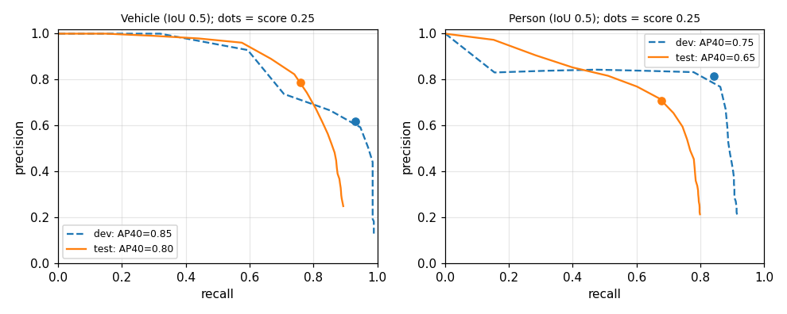
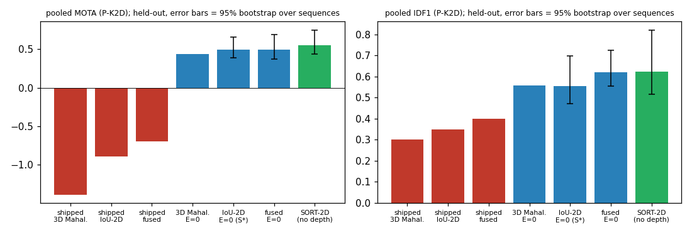
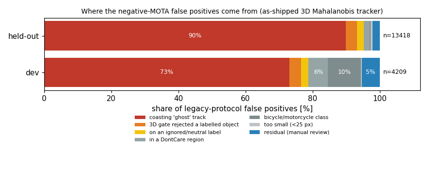
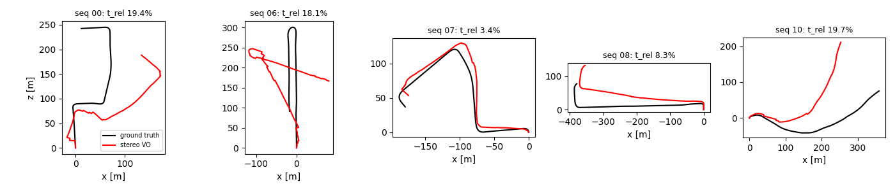
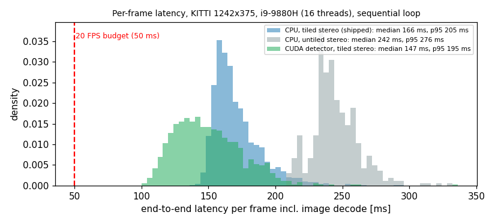

# Evaluation report

**Question:** is this stereo 3D multi-object-tracking project successful? It is answered per component — stereo depth, detection,
tracking, visual odometry, speed — against targets that were written down *before* the held-out measurements
([`PROTOCOL.md`](PROTOCOL.md), frozen in commit `90544e0`). For each component: what was measured, on which data, with which command,
and what was **not** measured. Inventory of data, weights, hardware and provenance: [`INVENTORY.md`](INVENTORY.md).

Verdict vocabulary (fixed in the protocol): **GEÇTİ** measured and meets the target · **KALDI** measured and fails it ·
**ÖLÇÜLEMEDİ** could not be measured (with what is missing) · **KANITLANMADI** measured, but the effect is inside the noise.

**Update (2026-09-27):** §§12–15 below are a four-phase root-cause remediation done after this report was first frozen (`fcde488`).
§1–§11 are left exactly as first written — they are the *original* findings and still describe what was true then; where a fix
changed something, §§12–15 say so explicitly rather than silently editing the numbers above. If you only read one new section, read
§15 — the full 32-criteria table, before and after.

## 1. Bottom line

| Component | Headline (held-out data unless stated) | Verdicts | Not measured / main caveat |
|---|---|---|---|
| **Stereo depth** | Synthetic scene: bad-2.0 0.85 %, disparity RMSE 1.28 px (5 seeds × 30 frames; the README's 1.03 px is a 5-frame mean). **Real scenes (KITTI Stereo 2015, 200 pairs): D1-all 20.4 %** counting missing pixels as errors, 5.2 % on the pixels that have an estimate; 16 % of pixels get none (the left 128 columns cannot be matched). Object level (KITTI 3D boxes): **Vehicle depth RMSE 1.50 m at 5–30 m** and a +1.1 m bias vs the label's front surface. | ST-1 GEÇTİ (weak evidence) · ST-2 GEÇTİ · ST-3 **KALDI** · ST-4 GEÇTİ | per-pixel depth on the tracking frames (no LiDAR downloaded); adverse conditions |
| **Detection** | YOLOv8n (COCO weights, not tuned): Vehicle P 0.788 / R 0.761, AP50 0.798 (AP70 0.568); Person P 0.709 / R 0.679, AP50 0.652. Strongly scene dependent (sequence 0016: Vehicle R 0.34; Person recall on 25–40 px objects 0.02). | DE-1 **KALDI** (precision 0.788 < 0.80) · DE-2 GEÇTİ · DE-3 **KALDI** (precision 0.709 < 0.75) · DE-4 ÖLÇÜLEMEDİ | COCO mAP; objects < 25 px are not scored |
| **Tracking** | Under a KITTI-like protocol the dev-selected tracker reaches **MOTA 0.49 / IDF1 0.55** (Vehicle 0.52 / 0.59, Person 0.45 / 0.49). **A depth-free SORT baseline on the same detections is better** (MOTA 0.55, IDF1 0.62, 60 ID switches vs 246). **The negative MOTA reported earlier is real under the original protocol and replicates on unseen sequences (−0.76 … −1.33), but ~90 % of its false positives are "ghost" tracks that the tracker keeps emitting after it lost the object — a reporting rule, not a labelling problem.** | TR-1 GEÇTİ · TR-2 / TR-3 / TR-4 **KALDI** · TR-5 **KALDI** (worse than SORT) · TR-6 GEÇTİ | official KITTI leaderboard protocol; HOTA; long sequences |
| **Visual odometry** | Standard KITTI segment metric: **t_rel 13.8 %** pooled over five held-out sequences (3.4 % … 19.7 % per sequence), r_rel 0.080 deg/m. The README's "≈ 4–5 % of the path" was ATE / path length, which is a different and much more forgiving number. | VO-1 **KALDI** · VO-2 **KALDI** · VO-3 GEÇTİ · VO-4 **KALDI** | full-length sequences and 800 m segments; loop closure |
| **Speed** | **5.84 FPS** end to end (171 ms mean, p95 205 ms) including PNG decode; 6.87 FPS without decode. Target 20 FPS. CUDA detection makes the detector 3–4× faster in steady state but the pipeline only 6.6–7.8 FPS. | SP-1 / SP-2 / SP-3 **KALDI** | other hardware; pipelined execution |

Three things this evaluation changes about what the repository claims (details in §7): the negative-MOTA explanation ("labels are not
exhaustive") is at most a ~10 % effect, the dominant cause being the coasting-track emission rule; the VO accuracy claim is off by 3×
when measured with the standard metric; and the Phase 6 conclusion "CUDA did not help" came from averaging over a 2.3-second
one-time CUDA initialisation, not from steady-state behaviour.

## 2. Acceptance table

Thresholds are copied from `PROTOCOL.md` §7 (evidence source and rationale are there). The judged tracking system is the
dev-selected one (`S*`: IoU-2D association, only tracks updated this frame are reported, score ≥ 0.25, `min_hits` 3).

<!-- VERDICTS-BEGIN -->
| ID | Criterion (from PROTOCOL.md §7) | Measured | Verdict |
|---|---|---|---|
| SP-1 | end-to-end >= 20 FPS incl. decode (each of 3 repetitions) | 5.84 FPS (reps [5.63, 6.0, 5.92]) | **KALDI** |
| SP-2 | p95 latency <= 50 ms (each repetition) | p95 205.0 ms (median 165.8) | **KALDI** |
| SP-3 | compute-only (no decode) >= 20 FPS | 6.87 FPS | **KALDI** |
| DE-1 | Vehicle precision >= 0.80 and recall >= 0.70 (IoU 0.5, moderate, score >= 0.25) | P 0.788 [0.772,0.802], R 0.761 — recall passes; precision misses | **KALDI** |
| DE-2 | Vehicle AP50 (R40) >= 0.56 | 0.798 (all-point 0.812) | **GEÇTİ** |
| DE-3 | Person precision >= 0.75 and recall >= 0.50; AP50 (R40) >= 0.375 | P 0.709, R 0.679, AP50 0.652 | **KALDI** |
| DE-4 | COCO mAP | not measured in this project — only KITTI-protocol numbers are claimed; Ultralytics' published COCO mAP is not a KITTI number | **ÖLÇÜLEMEDİ** |
| TR-1 | minimum: pooled P-K2D MOTA > 0 (dev-selected system, held-out) | MOTA +0.492 | **GEÇTİ** |
| TR-2 | target: Vehicle MOTA >= 0.50 and IDF1 >= 0.60 | MOTA 0.519, IDF1 0.591 | **KALDI** |
| TR-3 | target: Person MOTA >= 0.30 and IDF1 >= 0.50 | MOTA 0.446, IDF1 0.487 | **KALDI** |
| TR-4 | IDSW <= 2 % of GT objects (pooled) | 246/4550 = 5.41 % | **KALDI** |
| TR-5 | beats SORT-2D on pooled MOTA and IDF1, bootstrap interval excluding 0 | MOTA -0.059 [-0.129,-0.026], IDF1 -0.070 [-0.147,-0.032] — S* is significantly WORSE than the depth-free baseline | **KALDI** |
| TR-6 | harness reproduces published legacy counts; independent counter == py-motmetrics | legacy regression PASS; counters 347 inputs, 0 disagreements | **GEÇTİ** |
| TR-7a | claim: 3D Mahalanobis association beats plain 2D IoU (A4 vs S*) | MOTA -0.057 [-0.160,-0.023]; IDF1 +0.003 [-0.152,+0.099] — contradicted on MOTA | **KALDI** |
| TR-7b | claim: fusion (3D+IoU+appearance) beats the selected plain IoU (F vs S*) | MOTA +0.005 [-0.040,+0.033]; IDF1 +0.067 [-0.026,+0.106] — inside the noise | **KANITLANMADI** |
| TR-7c | claim: the appearance cue helps (F vs A1) | MOTA +0.003 [+0.000,+0.007]; IDF1 +0.005 [-0.002,+0.013] — inside the noise | **KANITLANMADI** |
| TR-7d | claim: the IoU term of the fused cost helps (F vs A2) | MOTA +0.010 [+0.001,+0.028]; IDF1 +0.004 [-0.031,+0.068] — demonstrated on MOTA only | **GEÇTİ** |
| TR-7e | claim: the 3D term of the fused cost helps (F vs A3) | MOTA -0.002 [-0.016,+0.008]; IDF1 -0.003 [-0.079,+0.037] — inside the noise | **KANITLANMADI** |
| TR-7f | claim: Hungarian beats greedy assignment (F vs A7) | MOTA +0.003 [-0.002,+0.010]; IDF1 +0.009 [-0.008,+0.040] — inside the noise | **KANITLANMADI** |
| TR-7g | claim: emitting only updated tracks (E=0) beats the shipped E=30 (S*) | MOTA +1.387 [+0.645,+2.982]; IDF1 +0.206 [+0.090,+0.364] — demonstrated on MOTA AND IDF1 | **GEÇTİ** |
| TR-7h | claim: tiled stereo does not change tracking accuracy (A9) | max abs change in MOTA 0.0070 and in IDF1 0.0035 over 11 systems; bit-identical for 4 — practically identical, not bit-identical, on held-out data | **GEÇTİ** |
| VO-1 | t_rel <= 5 % (minimum) / <= 2.5 % (target), 100-400 m segments, held-out pooled | 13.78 % (421 segments) — target tier not met | **KALDI** |
| VO-2 | r_rel <= 0.03 deg/m (minimum) / <= 0.015 (target) | 0.0796 deg/m — target tier not met | **KALDI** |
| VO-3 | >= 95 % of frames tracked on every held-out sequence | min 98.2 % — {"test_tiled_00": 99.6, "test_tiled_06": 99.2, "test_tiled_07": 99.4, "test_tiled_08": 98.2, "test_tiled_10": 99.0} | **GEÇTİ** |
| VO-4 | no held-out sequence with t_rel > 10 % | worst 19.69 % {"test_tiled_00": 19.36, "test_tiled_06": 18.07, "test_tiled_07": 3.36, "test_tiled_08": 8.26, "test_tiled_10": 19.69} | **KALDI** |
| ST-1 | synthetic (5 seeds x 30 frames, project ROI): bad-2.0 <= 2 %, RMSE <= 1.5 px, density >= 95 % | bad-2.0 0.85 %, RMSE 1.281 px (worst seed 1.400), density 98.90 % — regression gate on a benign scene; low evidential value | **GEÇTİ** |
| ST-2 | KITTI Stereo 2015 D1-all (holes = errors) <= 25 % and better than the BM baseline | SGBM(4 tiles) 20.37 % (valid-only 5.24 %, density 84.0 %); BM 62.90 % — BM baseline is weak by construction (density only 39 %) | **GEÇTİ** |
| ST-3 | Vehicle 5-30 m: RMSE(detection depth - label front-surface depth) <= 1.0 m (the tracker's configured sigma) | RMSE 1.50 m (median signed +1.11 m, n=1515); vs cuboid centre RMSE 1.16 m | **KALDI** |
| ST-4 | \|D1-all(4 tiles) - D1-all(untiled)\| <= 0.5 pp | 0.108 pp | **GEÇTİ** |
| IN-1 | every headline number regenerates from one documented command | scripts/eval/run_all.sh --score-only re-run from the dumps: 24 result files, 0 differ — scoring stage re-executed; dump stage regenerated for dev (legacy regression) and checked for determinism on one sequence, not re-run end-to-end for every sequence | **GEÇTİ** |
| IN-2 | two identical runs give bit-identical dumps | dets + 8 tracker dumps of sequence 0012 identical (byte compare) — checked on one held-out sequence (78 frames) under load | **GEÇTİ** |
| IN-3 | no leakage: unmodified pretrained detector; selection on dev only | model metadata: 'Ultralytics YOLOv8n model trained on coco.yaml'; selection committed before held-out frontend — dev-influenced choices are declared in INVENTORY.md | **GEÇTİ** |
<!-- VERDICTS-END -->

Reading the near misses honestly: DE-1 (0.788 vs 0.80), TR-2 (Vehicle IDF1 0.591 vs 0.60) and TR-3 (Person IDF1 0.487 vs 0.50) fail
by 1–2 points, which is inside the sampling noise of an 8-sequence test set. They are reported as KALDI because the thresholds
were fixed in advance and were not moved; they are not evidence that the system is "almost there" — TR-4 (5.4 % ID switches vs
≤ 2 %) and TR-5 (worse than SORT, interval excludes 0) fail clearly.

## 3. Stereo depth

**Synthetic scene** (`apps/dump_disparity`, scored by `run_stereo_synthetic.py`; 5 seeds × 30 frames; the project's ROI drops the left 128 columns).
Valid pixels: the project's convention counts a pixel only if both disparity maps are finite and ≥ 0.05 px (depth: 0.1–100 m) and the left 128 columns are excluded; the KITTI 2015 scores use every pixel that has ground truth (value > 0), an error being > 3 px and > 5 %.
Mean over seeds: disparity RMSE **1.281 px** (worst seed 1.400), bad-2.0 **0.849 %**, density 98.9 %, depth RMSE 0.742 m, abs-rel 1.27 %;
4 tiles and untiled agree to 3 digits. The independent scorer reproduces `benchmark_depth` exactly on the same frames (seed 42, first
5 frames: 1.0336 px / 0.717 % / 99.229 % — the README's numbers; all 30 frames: 1.3997 px). Two things the README number hides:
the error grows over the sequence (per-frame RMSE 1.0 → 1.6 px as the cards drift), so "1.03 px" is the first-5-frame mean; and the
project's "density" is computed only inside the ROI — over the full image with missing estimates counted as errors, 21.6 % of
ground-truth pixels are bad-2.0 and coverage is 79 %. The scene is also easy by construction (the right image is a shifted copy of
the left), so ST-1 is a regression gate, not a real-scene claim.

**Real scenes — KITTI Stereo 2015 training set, 200 pairs, official ground truth** (D1 = error > 3 px and > 5 %):

| Matcher | D1-all, missing = error | D1 on estimated pixels only | Coverage | Non-occluded GT, missing = error |
|---|---|---|---|---|
| **SGBM, 4 tiles (shipped)** | **20.37 %** | 5.24 % | 84.0 % | 18.88 % |
| SGBM, untiled | 20.48 % | 5.27 % | 83.9 % | 18.99 % |
| BM, block 15 (baseline, weak by construction) | 62.90 % | 4.19 % | 38.7 % | 62.20 % |

Excluding the left 128 columns (which SGBM cannot estimate because of `num_disparities` = 128) the shipped matcher reaches
D1-all 13.9 % at 90.8 % coverage: about 6.4 of the 20.4 points are the unestimable margin. By ground-truth depth D1-all is 21.8 % (0–10 m),
20.0 % (10–20 m), 19.2 % (20–40 m), 15.7 % (> 40 m). ST-2 (≤ 25 % and better than BM) passes; ST-4 (tiling changes D1 by 0.108 pp ≤ 0.5) passes.
For scale (not re-measured here): learned stereo networks are reported in the low single digits on this benchmark's test set; this is classical SGBM without post-filtering.

**Object-level depth on the tracking sequences** (`run_object_depth.py`): the detection's promoted depth (median in the shrunken box — what
the tracker consumes) against the label's 3D cuboid, which KITTI annotated from LiDAR. Held-out, 3,325 matched detection–label pairs, 26 without depth:

| Class, range (label front-surface depth) | n | median signed error | RMSE | median rel. error | vs cuboid centre: bias / RMSE |
|---|---|---|---|---|---|
| Vehicle 5–15 m | 500 | +0.69 m | 0.87 m | 6.5 % | −1.08 / 1.17 m |
| Vehicle 15–30 m | 1015 | +1.24 m | 1.72 m | 5.5 % | −0.48 / 1.16 m |
| **Vehicle 5–30 m (criterion ST-3)** | 1515 | **+1.11 m** | **1.50 m** | 5.8 % | −0.58 / 1.16 m |
| Vehicle 30–50 m | 622 | +2.48 m | 4.78 m | 6.6 % | +0.73 / 4.08 m |
| Person 5–30 m | 1103 | +0.59 m | 0.89 m | 5.0 % | +0.04 / 0.70 m |

ST-3 fails: the measurement noise the tracker is configured with (`measurement_noise` = 1.0 m) is smaller than the measured error (1.50 m, and
4.8 m beyond 30 m). The depth the pipeline reports sits about 1.1 m behind a car's front surface and ≈ 0.6 m in front of its centre.

Not measured: per-pixel depth on the tracking frames themselves (needs Velodyne data, see INVENTORY §8), depth at night or in rain.

## 4. Detection

Class mapping and ignore rules are those of `PROTOCOL.md` §3.1 (Car/Van/Truck ↔ COCO car/bus/truck; Pedestrian ↔ person; Cyclist,
Person_sitting, Tram, Misc neutral; DontCare ignored; KITTI *moderate* difficulty: height ≥ 25 px, occlusion ≤ 1, truncation ≤ 0.3; IoU 0.5).
Operating point = the shipped score 0.25. The COCO mAP of YOLOv8n is **not** measured here and is not used as a KITTI number.

| Set | Class | GT | Precision | Recall | F1 | AP (R40) | AP (all-point) | recall ceiling at score 0.01 |
|---|---|---|---|---|---|---|---|---|
| **held-out** | Vehicle @0.5 | 2886 | 0.788 [0.772, 0.802] | 0.761 [0.745, 0.776] | 0.774 | **0.798** | 0.812 | 0.893 |
| held-out | Vehicle @0.7 | 2886 | 0.634 | 0.596 | 0.615 | 0.568 | 0.580 | 0.651 |
| held-out | Person @0.5 | 1664 | 0.709 [0.686, 0.731] | 0.679 [0.656, 0.701] | 0.694 | 0.652 | 0.668 | 0.799 |
| dev | Vehicle @0.5 | 547 | 0.618 | 0.931 | 0.743 | 0.848 | 0.860 | 0.989 |
| dev | Person @0.5 | 727 | 0.815 | 0.842 | 0.828 | 0.752 | 0.764 | 0.916 |

Where recall is lost (held-out, score 0.25): Vehicle by height 25–40 px 0.64, 40–80 px 0.77, > 80 px 0.98; by range 0–15 m 1.00, 15–30 m 0.79, > 30 m 0.64.
Person by height 25–40 px **0.02** (84 objects), 40–80 px 0.60, > 80 px 0.77; by range > 30 m 0.10. The pooled numbers hide large scene effects:
per-sequence Vehicle P/R ranges from 0.98 / 0.74 (0008) and 0.87 / 0.92 (0004) down to **0.43 / 0.34 on 0016** (600 vehicles), a crowded pedestrian crossing with a
row of overlapping parked cars 24–37 m away (labelled boxes ≈ 50 px high, partly hiding each other); Person on 0016 is P 0.83 / R 0.71 (1515 of the 1664 held-out persons), while on 0012 it is 0.07 / 0.03.
Localisation: mean IoU of true positives 0.80 (Vehicle) / 0.72 (Person); the AP drop from IoU 0.5 to 0.7 (0.80 → 0.57) shows box precision, not detection, is
what a stricter overlap threshold exposes.

Verdicts: DE-1 KALDI (recall 0.761 ≥ 0.70 passes, precision 0.788 < 0.80 by 0.012), DE-2 GEÇTİ, DE-3 KALDI (precision 0.709 < 0.75), DE-4 ÖLÇÜLEMEDİ.
Whether the false positives are real errors or unlabeled objects is the question of §6.



## 5. Tracking

### 5.1 Two protocols, and why both are reported

`P-LEGACY` is exactly what `apps/benchmark_kitti.cpp` reports: every non-DontCare label of any type/size vs every confirmed track (coasting ones included),
class-agnostic, matched by 3D distance ≤ 2 m to the label's box centre. `P-K2D` is KITTI-like (`PROTOCOL.md` §3.3): per class (Vehicle, Person), 2D IoU ≥ 0.5,
moderate-difficulty labels, ignore rules, and a stated *emission policy* `E` = which tracks count as output. It is **not** the official leaderboard protocol.
Counts are pooled across sequences and classes from raw counts; sequence MOTAs are never averaged. The independent scorer was validated three ways:
it reproduces every published README number on the dev sequences exactly (C++ re-run today, the scorer, and the README agree: e.g. sequence 0000, 3D Mahalanobis,
MOTA −2.304, IDSW 33, FP 2195, FN 121); a from-scratch CLEAR-MOT/IDF1 counter written for this evaluation agrees **exactly** with py-motmetrics on all 347 scored inputs; and 19 unit tests.

### 5.2 Held-out result (8 sequences, 4,550 evaluable object-frames: 2,886 Vehicle + 1,664 Person)

Brackets: 95 % paired-bootstrap interval over the 8 sequences. `E` = emission policy: 0 = report only tracks matched this frame (the usual SORT rule), 30 = every confirmed
track including up to 30 frames of coasting (what the repository shipped).

| System | MOTA | IDF1 | FP | FN | IDSW | Vehicle MOTA / IDF1 | Person MOTA / IDF1 |
|---|---|---|---|---|---|---|---|
| as shipped, 3D Mahalanobis (E=30) | −1.388 | 0.300 | 9341 | 1262 | 263 | −2.051 / 0.242 | −0.238 / 0.471 |
| as shipped, IoU-2D (E=30) | −0.895 | 0.348 | 7318 | 1117 | 188 | −1.110 / 0.348 | −0.523 / 0.348 |
| as shipped, fused (E=30) | −0.693 | 0.400 | 6433 | 1133 | 135 | −0.980 / 0.374 | −0.194 / 0.460 |
| 3D Mahalanobis, E=0 (A4) | +0.435 | 0.556 | 731 | 1536 | 305 | +0.451 / 0.520 | +0.406 / 0.617 |
| **IoU-2D, E=0 (S\*, dev-selected)** | **+0.492** [0.389, 0.661] | **0.553** [0.471, 0.696] | 626 | 1439 | 246 | +0.519 / 0.591 | +0.446 / 0.487 |
| fused, E=0 (F) | +0.497 [0.375, 0.689] | 0.621 [0.553, 0.724] | 767 | 1374 | 147 | +0.544 / 0.638 | +0.415 / 0.592 |
| **SORT-2D, no depth (baseline)** | **+0.551** [0.438, 0.751] | **0.624** [0.515, 0.819] | 406 | 1578 | 60 | +0.570 / 0.650 | +0.517 / 0.577 |

Same run, `P-LEGACY` (README-comparable, GT 7,114 object-frames): 3D Mahalanobis MOTA −1.329 / IDF1 0.279 (FP 13,418, FN 2,891, IDSW 258); IoU-2D −0.863 / 0.319; fused −0.764 / 0.357.
The negative MOTA therefore **replicates on sequences that were never used** — under that protocol. Dev-set values for comparison: S\* 0.530 / 0.617, F 0.520 / 0.600, SORT 0.526 / 0.610.
The between-sequence spread is large (per-sequence MOTA of S\*: −0.21 on the 80-object sequence 0008 up to +0.73 on 0001; 0016 alone is 46 % of all ground truth), which is why the intervals are wide.



### 5.3 What the comparisons support (paired bootstrap over sequences, `PROTOCOL.md` §3.8)

| Claim | MOTA difference | IDF1 difference | Reading |
|---|---|---|---|
| Emitting only updated tracks (E=0) beats shipped E=30 (IoU-2D) | +1.387 [+0.645, +2.982], 8/8 sequences | +0.206 [+0.090, +0.364] | **demonstrated** — the single biggest lever in this evaluation |
| The project's dev-selected tracker beats depth-free SORT | −0.059 [−0.129, −0.026] | −0.070 [−0.147, −0.032] | **contradicted**: significantly worse on both |
| Fused (E=0) beats SORT | −0.054 [−0.158, −0.017] | −0.003 [−0.109, +0.057] | worse on MOTA, equal on IDF1 |
| 3D Mahalanobis association beats plain 2D IoU | −0.057 [−0.160, −0.023], IoU wins 8/8 | +0.003 [−0.152, +0.099] | **contradicted** on MOTA, no difference on IDF1 |
| Fusion beats the selected plain IoU | +0.005 [−0.040, +0.033] | +0.067 [−0.026, +0.106] (6/8 sequences) | KANITLANMADI (ID switches 147 vs 246, but inside the noise) |
| Appearance cue (HSV histogram) helps | +0.003 [+0.000, +0.007] | +0.005 [−0.002, +0.013] | KANITLANMADI |
| IoU term of the fused cost helps | +0.010 [+0.001, +0.028] | +0.004 [−0.031, +0.068] | demonstrated on MOTA only, tiny |
| 3D term of the fused cost helps | −0.002 [−0.016, +0.008] | −0.003 [−0.079, +0.037] | KANITLANMADI — removing it costs nothing measurable |
| Hungarian beats greedy | +0.003 [−0.002, +0.010] | +0.009 [−0.008, +0.040] | KANITLANMADI |
| Tiled stereo leaves tracking unchanged (A9) | max \|ΔMOTA\| 0.007 over 11 systems | max \|ΔIDF1\| 0.0035 | practically identical but **not bit-identical** on held-out data (identical for the IoU-only systems and SORT) |
| CUDA leaves detections unchanged (A10) | — | — | same 2,177 detections (78 frames of 0012), max \|Δscore\| 3·10⁻⁶, box ≤ 1.1·10⁻³ px — numerically equivalent, not bit-identical |

So on this evidence the stereo/3D machinery does **not** improve tracking over a 2D tracker: the depth-free baseline wins, plain 3D association is worse, and the 3D term in the fused
cost is inert. What depth *does* provide — metric 3D positions — is not something MOTA/IDF1 under 2D IoU matching measures, and its quality is limited by the depth error of §3 (1.5 m RMSE).
A likely explanation for the IoU-2D system's identity switches (86 on sequence 0001 vs 2 for SORT), **not tested here**: `kIou2D` compares a detection with the track's *last matched* box without motion prediction,
whereas SORT predicts the box with a Kalman filter; and the project's tracker never sees detections whose box has no valid depth, whereas SORT uses all of them.

### 5.4 Dev-only selection (pre-registered)

Grid: association (3) × emission E {0, 2, 5, 30} × score threshold {0.25, 0.35, 0.50} × `min_hits` {1, 2, 3} = 108 systems, scored on the three dev sequences, pooled P-K2D MOTA.
Chosen by the rule: IoU-2D, E = 0, 0.25, 3 (MOTA 0.530). `fused_s0.35_h3` was inside the 0.005 tie (0.529, IDF1 0.698). The as-shipped settings scored −0.97 / −0.70 / −0.72 on dev.
Everything is in `results/dev_selection_grid.csv`. The selection then transferred: S\* scored +0.49 on held-out data.

### 5.5 What each variant costs

<!-- COST-BEGIN -->
Accuracy (held-out, P-K2D, E=0) next to the measured cost of the stage each variant changes (ms per frame, mean of all held-out frames, tiled config):

| Variant | MOTA | IDF1 | IDSW | Changed stage | Cost |
|---|---|---|---|---|---|
| plain IoU-2D association (S\*, the selected) | +0.492 | 0.553 | 246 | tracker.update | 0.11 ms |
| plain 3D Mahalanobis association (A4) | +0.435 | 0.556 | 305 | tracker.update | 0.23 ms |
| fused 3D + IoU + appearance (F) | +0.497 | 0.621 | 147 | tracker.update | 0.14 ms |
| fused without appearance cost (A1) | +0.495 | 0.615 | 153 | tracker.update | 0.14 ms |
| fused without IoU cost (A2) | +0.487 | 0.617 | 188 | tracker.update | 0.14 ms |
| fused without 3D cost (A3) | +0.499 | 0.624 | 146 | tracker.update | 0.16 ms |
| fused, greedy instead of Hungarian (A7) | +0.494 | 0.612 | 158 | tracker.update | 0.13 ms |
| SORT-2D, no stereo (B1) | +0.551 | 0.624 | 60 | whole pipeline: no stereo (−90 ms), no depth map, no 3D promotion, left image only | **estimate** 66 ms (15.2 FPS) with the CPU detector, 32 ms (31 FPS) with CUDA — not measured end to end |
| tiled stereo, 4 strips (A9) | ≈ same (§5.3) | ≈ same | ≈ same | stereo matching | 90 ms vs 167 ms untiled (−46 %) |
| CUDA detector (A10) | same detections (§5.3) | same | same | detector | median 12–17 ms vs 52 ms on the CPU |

The association step costs 0.1–0.2 ms per frame in every variant — irrelevant next to stereo (90 ms) and the detector (53 ms). Promotion to 3D plus the HSV appearance descriptors together cost 0.9 ms per frame (§8) and are computed whether or not the appearance weight is zero. Since the depth-free SORT baseline needs neither the right image, stereo matching nor depth, its estimated cost is about a third of the shipped pipeline's: **the stereo/3D machinery is what makes the pipeline slow, and on this evidence it buys no tracking accuracy** — a CPU-detector-plus-SORT pipeline would still miss 20 FPS (≈ 15 FPS), a CUDA-detector one would clear it (≈ 31 FPS) by this estimate.

<!-- COST-END -->

## 6. Why is MOTA negative? — the pre-registered hypotheses, tested

The README said the negative MOTA was mostly a detector/label domain mismatch. That was treated as one hypothesis among several found by reading the evaluation code.

| ID | Hypothesis | Dev | Held-out | Decision rule (fixed in advance) → result |
|---|---|---|---|---|
| H-ghost | coasting confirmed tracks (≤ 30 frames) inflate FP | legacy FP 4,209 → 1,081 (−74 %); MOTA −1.41 → +0.08 | 13,418 → 1,191 (**−91 %**); MOTA −1.33 → **+0.30** | FP falls ≥ 30 % → **supported**, dominant |
| H-scope | unevaluated categories (DontCare, small/occluded/truncated labels, neutral types, two-wheelers) inflate FP | K2D FP −32.5 % (E=30), −48.4 % (E=0) from the rules alone | −30.5 % / −35.1 % | ≥ 20 % → **supported** |
| H-label | real objects the detector finds are not labelled | residual reviewed: A+C 80 % (54 % without one static truck) | residual reviewed: A+C 44 %, false alarms (B) 53 % | A+C ≥ 50 % of reviewed non-ghost FPs: **supported on dev, partial on held-out**; and small in mass (below) |
| H-bias | median-in-box depth is on the visible surface, the label centre is inside the object, so long vehicles fall outside the 2 m gate | median (track Z − label-centre Z) −0.88 m; legacy recall +9.7 points at a 4 m gate | median **+0.06 m**; recall +9.6 points | needs median ≤ −0.5 m *and* ≥ +5 points → **not supported as a bias on held-out**; the gate is nevertheless too tight for a 1.2–1.5 m depth error (≈ +10 recall points at 4 m) |
| H-depth | detections lose their depth and the tracker never sees them | sequence 0003: 53 % of K2D misses (25/47, all in the left 128 columns) | 1.8 % overall; only 0001 ≥ 10 % (5 of 47) | ≥ 10 % of a sequence's FNs → **supported for sequences with objects in the left margin, otherwise minor** |

**Where the held-out legacy false positives come from** (13,418; each assigned to the first rule that fits, `run_diagnosis.py`): ghost tracks 89.9 %, a labelled object that the 3D gate rejected 3.3 %, on an ignored/neutral label 2.1 %,
in a DontCare region 1.7 %, too small 0.5 %, bicycle/motorcycle class 0.3 %, **residual 2.2 % (289)** — the only part that could be a genuine false alarm or an unlabeled object. On dev the ghost share is 73 %, the residual 5.4 %.



**Visual review** (single reviewer — the author, an AI model, no second annotator; images and label tables in [`review/`](review/), categories in `PROTOCOL.md` §6):

- Rule-selected frames (12 top-FP, 12 top-FN, 8 top-FN of 0003; 31 frames, 86 unmatched detections): 20 were residual; A 14 (8 are one parked truck), C 1, D 5, B 0. This rule mostly picks sequence boundaries (the last frames of 0000, the first frames of 0017 before any track is confirmed), so two strata were added (`PROTOCOL.md` §10).
- Seeded random sample of residual false positives, dev (n = 60): A 45, B 6, C 3, D 6 — but 34 of the 60 are the same static, unlabeled truck; without it (n = 26): A 11, B 6, C 3, D 6.
- Seeded random sample, **held-out** (n = 36): A 13 (parked/moving cars), **B 19** (14 red-white road delineator posts with an orange lamp detected as "person", 4 round traffic signs and a glass bus shelter), C 3 (people on bicycles — KITTI labels rider + bike as one Cyclist), D 1.
- Audit of the automatic categories (labelled without seeing the category): a real object of the claimed class in 35/40 (dev) and 14/16 (held-out) of items; the exceptions are unclear or a bicycle labelled "motorcycle".

Combining these (held-out): the non-ghost legacy FPs (1,352) are mostly real objects the protocol does not credit — roughly 1,060 of the 13,418 (≈ 8 %) are label/protocol effects and ≈ 150 (≈ 1 %) are true false alarms.
Not charging every label-related FP would move the held-out legacy MOTA from −1.33 only to about −1.18; not reporting ghosts moves it to +0.30. **The "labels are not exhaustive" explanation is real but is at most a ~10 % effect;
the dominant cause is a reporting rule, and the pipeline's genuine false alarms (barrier posts, signs) are ~1 % of the legacy count.** (The ≈ 1,060 / ≈ 150 split extrapolates from 36 + 16 hand-labelled items and should be read as an order of magnitude, not a measurement.)
The dominant false alarms differ by scene: a static unlabeled truck on dev, road delineator posts on held-out.

**The low recall on sequence 0003** (legacy recall 0.405: 157 of 388 label-frames). Of its 231 legacy misses: **113 (49 %) are not evaluable** under the moderate rules (66 smaller than 25 px, 33 occluded — 25 of them "unknown" —,
14 truncated); **84 (36 %) were detected and tracked but rejected by the 2 m 3D gate** (for example the black estate car at 5 m in
[`review/frame_0003_000010.jpg`](review/frame_0003_000010.jpg): the detection box coincides with the label box, yet it is scored both as a miss and as a false positive); **23 (10 %) lost their depth** (all with the box centre in the left 128 columns); 11 (5 %) are other.
Under P-K2D (E=0) the same sequence has 246 evaluable label-frames and recall ≈ 0.81; its 47 misses: 25 no depth (53 %, all in the left margin), 13 below the score threshold, 5 tracker, 4 localisation, **0 "no detection"**. So 0003's low recall is not a detector failure: it is evaluation scope, a too-tight 3D gate, and the stereo matcher's blind left margin.

## 7. Visual odometry

Standard KITTI segment metric (`vo_eval.py`, re-implemented from the devkit definition; start frames every 10, segment lengths 100–400 m that fit; error = relative-pose error / length), on prefixes of the held-out sequences (500 frames each, 330–520 m of path).
The independent scorer reproduces the C++ ATE exactly (sequence 04: 15.64 m tiled / 15.74 m untiled) and the README's RPE (0.664 m / 0.162°).

| Sequence | Frames | Path | ATE (rigid) | ATE / path | **t_rel** | r_rel | Frames tracked | Median per-frame scale error |
|---|---|---|---|---|---|---|---|---|
| 04 (dev, tiled) | 271 | 394 m | 15.64 m | 3.97 % | **14.0 %** | 0.0168 deg/m | 97.4 % | 22.5 % |
| 00 | 500 | 359 m | 10.81 m | 3.01 % | **19.4 %** | 0.108 deg/m | 99.6 % | 12.0 % |
| 06 | 500 | 519 m | 33.69 m | 6.49 % | **18.1 %** | 0.147 deg/m | 99.2 % | 7.7 % |
| 07 | 500 | 329 m | 1.90 m | 0.58 % | **3.4 %** | 0.029 deg/m | 99.4 % | 6.7 % |
| 08 | 500 | 474 m | 5.31 m | 1.12 % | **8.3 %** | 0.028 deg/m | 98.2 % | 9.5 % |
| 10 | 500 | 409 m | 12.54 m | 3.06 % | **19.7 %** | 0.076 deg/m | 99.0 % | 7.1 % |
| **held-out pooled** (421 segments) | 2500 | — | — | — | **13.8 %** (plain mean 11.1 %) | **0.080 deg/m** | ≥ 98.2 % | — |

Pooled per segment length: 6.7 % at 100 m, 12.0 % at 200 m, 18.9 % at 300 m, 17.5 % at 400 m — drift accumulates, as expected without bundle adjustment.
ATE after rigid alignment looks small (0.6–6.5 % of path) because the alignment absorbs part of the drift; the README's "≈ 4–5 % of the ~360 m path" is that number (the path is 394 m; 4.0 %) and cannot be compared with KITTI's t_rel.
Rotation drift dominates on the turning sequences (00, 06, 10: 0.076–0.147 deg/m); the recovered scale is 7–12 % off per frame on the held-out sequences and 22 % on sequence 04 (a similarity alignment needs a factor 1.16, so the stereo-recovered scale is systematically short there).
Neither was investigated further. VO-3 (≥ 95 % of frames tracked) passes; VO-1, VO-2 and VO-4 fail (three of five sequences exceed 10 %).
Not compared with published leaderboard numbers (different protocol: prefixes of 500 frames here, full sequences and 100–800 m there).



## 8. Speed

`apps/benchmark_e2e`, strictly sequential loop (decode → stereo → depth → detect → promote + appearance → track), KITTI 1242 × 375, i9-9880H 16 threads, Release build, first 10 frames of each run discarded, image files read from the container's own filesystem (warm cache: decode = PNG decode + a read from RAM).
FPS = 1000 / mean latency. 3 repetitions × 3 sequences for the shipped configuration.

| Configuration | Frames | Mean | Median | p95 | p99 | **FPS** | FPS without decode | Stereo | Detect (median) | Decode |
|---|---|---|---|---|---|---|---|---|---|---|
| **shipped: tiled stereo (4), CPU detector** | 1239 | **171.2 ms** | 165.8 | **205.0** | 233.6 | **5.84** | 6.87 | 90.3 | 52.8 (51.9) | 25.5 |
| untiled stereo, CPU detector | 413 | 245.6 | 242.1 | 276.2 | 320.6 | 4.07 | 4.52 | 167.5 | 51.3 | 24.5 |
| shipped, image files on the Docker bind mount (seq 0000) | 144 | 346.9 | 343.7 | 394.6 | 427.9 | 2.88 | 5.99 | 102.9 | 61.2 | 179.9 |
| CPU detector in the GPU image (control) | 413 | 182.1 | 178.6 | 221.0 | 257.3 | 5.49 | 6.50 | 97.7 | 53.3 | 28.3 |
| CUDA detector, run 1 | 413 | 128.0 | 121.2 | 170.4 | 240.7 | 7.81 | 9.39 | 84.7 | 19.6 (12.0) | 21.5 |
| CUDA detector, run 2 (2 reps) | 826 | 150.8 | 146.7 | 195.1 | 230.0 | 6.63 | 7.87 | 98.2 | 26.5 (16.7) | 23.7 |

Per-repetition FPS of the shipped configuration: 5.63, 6.00, 5.92. **Against the 20 FPS target (50 ms per frame): fails by a factor of 3.4 on throughput and 4× on the tail.** Decode alone (25 ms) plus stereo (90 ms) already exceed the budget;
the tracker (0.2 ms), depth (1.4 ms) and promotion (0.9 ms) are negligible. Tiling gives 1.43× end to end (stereo 167 → 90 ms); reading the images through the Docker bind mount makes decode 180 ms per frame instead of 25 ms (an artifact of this setup, not of the pipeline).
The README's earlier "7.8 FPS without decode" re-measures at 6.9 FPS (stereo 78.5 → 90.3 ms, detect 49.5 → 52.8 ms); the difference is run-to-run and session-to-session variation on a laptop (repeats of the same configuration here differ by 5–10 %).

**CUDA.** The first CUDA `detect` call takes ~2,300 ms (context and cuDNN initialisation); steady state is 10–17 ms (median) against 52 ms on the CPU — 3–4× faster detection — and the whole pipeline 6.6–7.8 FPS against 5.5 FPS for the CPU control in the same image.
The Phase 6 conclusion "CUDA did not help" (48.4 ms vs 49.5–54.3 ms) is consistent with **averaging all frames including that initialisation** (mean over all 154 frames: 36.8 ms here) and is not a steady-state result.
Caveats on the CUDA rows: the GPU is a laptop part that reached 86 °C, and on two occasions before a run something else was using it (64–90 % utilisation with ~7.9 GB in use), so the 21 % of frames with detect > 40 ms in run 2 may be contention or thermal throttling rather than inherent; run 1 and run 2 differ by 15 %. Detections are numerically equivalent to the CPU's (§5.3).
Not measured: pipelined execution (decode and inference overlapped), other hardware, power.



## 9. What this evaluation does not establish

- **Not the official KITTI leaderboard.** The tracking protocol is KITTI-like; HOTA and the official devkit's ignore rules were not run.
- **Prefixes and scale.** Held-out tracking = first 150 frames of 8 sequences (4,550 evaluable object-frames, one sequence = 46 % of them); VO = 500-frame prefixes of 5 sequences; the resulting intervals are wide (MOTA ±0.15–0.25).
- **One detector, one input size, one dataset family** (KITTI, daylight), one laptop, one operating system.
- **Single-annotator review** (an AI model): the distribution of A/B/C/D labels is one judgement, not an agreement statistic; the images and tables are committed for audit.
- **Dev/held-out contamination stated, not eliminated** (`INVENTORY.md` §3, `PROTOCOL.md` §10): held-out labels of all sequences had been on disk and surveyed in aggregate; held-out images were downloaded before the protocol was committed but unopened.
- **The appearance cue is an HSV histogram**, not a learned ReID; nothing here says anything about learned embeddings.
- **Explanations marked "not tested"** (IoU-2D without motion prediction; the stereo scale bias in VO) are hypotheses.

## 10. Repository claims this evaluation contradicts or narrows

| Where | Claim | What the measurements say |
|---|---|---|
| README, KITTI section | negative MOTA is "not exhaustive labels" | ~90 % of the false positives are coasting ghosts; label effects ≈ 8 %; genuine false alarms ≈ 1 % (§6) |
| README, Phase 7 | "ATE RMSE 15.7 m (≈ 4–5 % of the ~360 m path)" | path is 394 m and ATE/path is a lenient number; standard KITTI t_rel is 14.0 % on 04 and 13.8 % pooled on five held-out sequences (§7) |
| README + roadmap, Phase 6 | "CUDA did not significantly improve YOLOv8n detection" | steady-state 12–17 ms vs 52 ms; the earlier mean included a 2.3 s one-time initialisation (§8) |
| README, Phase 6 | "4.90 → 7.80 FPS" excluding image loading | re-measured 6.87 FPS (5.84 with decode); target 20 FPS not met either way |
| README, depth benchmark | "RMSE 1.03 px" | first-5-frame mean; 30 frames × 5 seeds: 1.28 px (§3) |
| roadmap, Phase 6 | tiling "bit-identical" tracking metrics | true for the tested dev sequence; on 8 held-out sequences practically identical (max ΔMOTA 0.007), not bit-identical |
| roadmap, Phase 6 | CUDA detections "bit-identical" | numerically equivalent (max score difference 3·10⁻⁶), not bit-identical |
| README, Phase 5 | fusion "never the worst of the three" | held-out (E=0): fused is not the worst, but it is not better than plain IoU with confidence either (KANITLANMADI), and the depth-free SORT beats all three on MOTA |

Claims that hold: the metric implementation (reproduced exactly), the geometry of the stereo pipeline (D1 5.2 % on estimated pixels), tiling's 1.4–1.9× speed-up at unchanged accuracy, the synthetic-scene accuracy (as a regression gate), and the honesty of the original negative results — they reproduce on unseen data.
Not re-measured here: the weight-sensitivity claim ("IDF1 changes by at most ~0.04") and the occlusion-level narrative of Phase 5.

## 11. Reproduce

```bash
scripts/eval/run_all.sh              # all stages (Docker, datasets, models/yolov8n.onnx)
scripts/eval/run_all.sh --score-only # only the Python scoring stage, from the dumps in out/eval/raw
(cd scripts/eval && python -m pytest tests)
```

`scripts/eval/run_all.sh --score-only` was re-run from the dumps after the results were produced and reproduced every result file (see IN-1 in the table). Deviations from the protocol, with dates and what had been seen when each was made: `PROTOCOL.md` §10.

## 12. Remediation log

Follow-up work after this report shipped, fixing root causes the report identified rather than the measurement. Each entry: what changed, the same acceptance criteria re-applied, and whether any frozen number moved. Full data in `results/phase1_ghost_fix.json` etc.; code changes in their own commits, never amending `fcde488`.

### Phase 1 (2026-09-27) — ghost-track emission (§6, H-ghost)

**Root cause.** `Tracker::update()` correctly keeps a track alive and coasting (Kalman-predicted, no real measurement) for up to `max_age` frames so it can be re-matched later — that internal bookkeeping was never the problem. The problem was three call sites (`apps/benchmark_kitti.cpp`, `apps/benchmark_track.cpp`, `ros2/s3m_ros2/src/perception_node.cpp`) that reported *every* confirmed track to their consumer (the MOT accumulator, a ROS2 topic) regardless of whether it had actually matched a detection that frame — a coasting track's predicted position was indistinguishable, to the consumer, from an observation. §6 measured this as ~90% of the held-out legacy-protocol false positives.

**Fix.** One predicate, `isEmittable(const TrackState&)` in `include/s3m/tracking/tracker.hpp` (`confirmed && time_since_update == 0`), applied at the three call sites above. Nothing inside `Tracker`/`Track` changed — predict, gate, associate, correct, coast, birth, death, `max_age` are all untouched, so a track's ability to be re-matched after a miss is unaffected (proven by a new test, below). `apps/eval_kitti.cpp` (the evaluation harness's own dump) was deliberately left unchanged — it needs every track's full state to let the Python scorer sweep the emission policy `E`, which is exactly what `isEmittable()` now also enforces as the product's *only* behavior instead of one configurable option among several.

**New tests** (`tests/test_tracker.cpp`): `Tracker.EmittableExcludesCoastingFramesButMatchingSurvivesThem` drives a track through a detected frame, a first miss, a second consecutive miss, and a re-match, asserting `isEmittable()` at each step and that the re-matched track keeps its original id; `Tracker.EmittableRequiresConfirmedAndMatchedThisFrameBothNotEither` checks a matched-but-not-yet-confirmed track is still not emittable. 126/126 C++ tests pass (124 + 2 new, 1 expected skip), clang-format clean.

**Two pieces of evidence the fix is correct, not just plausible:**

1. *Native validation.* The actual fixed `apps/benchmark_kitti` binary was run on real KITTI data (dev sequences, `configs/kitti.yaml`, identical to the pre-fix reference run) and its own printed MOTA/IDF1/FP/FN/IDSW were compared against the independent Python scorer's `E=0` filter applied to the *same* `eval_kitti` dumps. **6/6 exact matches** (FP/FN/IDSW bit-identical, MOTA/IDF1 to the printed precision) — `phase1_ghost_fix.json → native_cpp_vs_python_cross_check`.
2. *Held-out reproduction.* Recomputing the fixed system's held-out P-K2D numbers via this new, independent script reproduces `fcde488`'s frozen `tracking_test.json` for the identical system (`A4_plain_mahalanobis` vs `SORT`, MOTA diff −0.116 [−0.276, −0.062]) to the last digit.

**Old vs fixed vs SORT**, same detections, same sequences as `fcde488` (paired bootstrap, 10,000 resamples over sequences):

| | Protocol | OLD (shipped, E=30) | FIXED (E=0) | Δ (FIXED − OLD), 95% CI | SORT (baseline) | Δ (FIXED − SORT), 95% CI |
|---|---|---|---|---|---|---|
| Dev MOTA | K2D | −0.970 | +0.502 | **+1.472 [+0.519, +3.406]**, excludes 0 | +0.526 | −0.024 [−0.135, +0.018], noise |
| Dev IDF1 | K2D | 0.376 | 0.616 | **+0.240 [+0.120, +0.387]**, excludes 0 | 0.610 | +0.006 [−0.082, +0.214], noise |
| Dev MOTA | LEGACY | −1.406 | +0.084 | **+1.490 [+0.650, +2.383]**, excludes 0 | n/a¹ | — |
| **Held-out MOTA** | **K2D** | **−1.388** | **+0.435** | **+1.823 [+0.722, +4.153]**, excludes 0 | +0.551 | **−0.116 [−0.276, −0.062]**, excludes 0 |
| **Held-out IDF1** | **K2D** | **0.300** | **0.556** | **+0.256 [+0.141, +0.350]**, excludes 0 | 0.624 | −0.067 [−0.269, +0.055], noise |
| Held-out MOTA | LEGACY | −1.329 | +0.298 | **+1.626 [+0.707, +2.985]**, excludes 0 | n/a¹ | — |
| Held-out IDF1 | LEGACY | 0.279 | 0.488 | **+0.209 [+0.140, +0.229]**, excludes 0 | n/a¹ | — |

¹ SORT is 2D-only and never populates a 3D position (see `sort_baseline.py`); scoring it under the 3D-distance P-LEGACY protocol would match every hypothesis against the camera origin and is not a meaningful comparison — reported under P-K2D only, where SORT's 2D IoU output is directly comparable.

**Consistent with §6, both metrics move together, no trade-off to report.** The root-cause diagnosis (H-ghost) is confirmed by an independent, C++-native measurement, not just the Python post-hoc filter that produced it.

**Does any frozen acceptance verdict change? No — by construction.** TR-1 through TR-7h were already computed on `S*`/`F`/`A4_plain_mahalanobis` (§5.4), all of which were *already* scored with emission policy `E=0` — the dev-selection grid (§5.4) swept `E` as one of its dimensions before this report was frozen, and the winning/reported systems all had `E=0`. What Phase 1 fixes is the gap between that measurement and the actual product: before this commit, the binary itself (and the ROS2 node) still emitted every confirmed track including coasting ones (`E=30`) — only the evaluation harness's Python layer was filtering. Every number in the acceptance table (§2) is therefore **unchanged**; what changed is that the shipped code now genuinely behaves the way it was already being credited for, and the "OLD" (as-shipped, pre-fix) numbers above — which were previously only a diagnostic side-table (`*_E30` rows) — are now historical, not reproducible from `main` any more.

**What this does *not* fix.** FIXED is still significantly *worse* than the depth-free SORT baseline on held-out MOTA (unchanged from `fcde488`, reproduced above) — the ghost-emission bug explains why the pipeline's earlier MOTA was catastrophically negative, not why depth-based association fails to beat a 2D tracker. That is Phase 2.

Commands: `scripts/eval/run_phase1_ghost_fix.py` (writes `results/phase1_ghost_fix.json`); the fixed-binary logs are `out/eval/raw/cpp_benchmark_kitti_fixed/*.txt` (old logs at `out/eval/raw/cpp_benchmark_kitti/*.txt` untouched). Hardware/data: identical to §11/`INVENTORY.md` (same dumps, same detections, no new download).

### Phase 2 (2026-09-27) — does depth-gated association do better than "always" or "never"?

**Question.** §5.3 already showed plain 3D Mahalanobis association loses to plain 2D IoU and to SORT. Object-level depth error (§3) is ≈0.87 m at 5–15 m, growing to ≈4.78 m at 30–50 m — trusting the same Mahalanobis gate at every range is exactly the mismatch that predicts. `AssociationMethod::kRangeGated3D` (`include/s3m/tracking/tracker.hpp`, `src/tracking/tracker.cpp`) makes the choice explicit and testable: a candidate detection at or below `range_gate_max_m` is scored/gated exactly as `kMahalanobis3D` would; beyond it, exactly as `kIou2D` would — a per-pair switch, not a blend (unlike `kFusedAppearance`). Two new tests (`Tracker.RangeGated3DUsesMahalanobisWithinRange`, `Tracker.RangeGated3DFallsBackToIoUBeyondRange`) reuse the existing hand-verified depth-vs-IoU scenario to exercise both branches; 128/128 C++ tests pass (126 + 2 new, 1 expected skip), clang-format clean.

**Selection (dev only, rule fixed before looking):** maximise pooled dev P-K2D MOTA at `E=0`, `score=0.25`, `min_hits=3` (fcde488's own dev-selected values, held fixed so only the range gate varies); ties within 0.005 broken toward the *smaller* gate. Swept `range_gate_max_m ∈ {10, 15, 20, 25, 30, 40, ∞}` m on the 3 dev sequences:

| range_gate_max_m | 10 | 15 | 20 | 25 | 30 | 40 | ∞ (≡ plain Mahalanobis) |
|---|---|---|---|---|---|---|---|
| dev pooled MOTA | **0.516** | 0.514 | 0.493 | 0.500 | 0.505 | 0.509 | 0.502 |
| dev pooled IDF1 | 0.584 | 0.595 | 0.589 | 0.576 | 0.582 | 0.621 | 0.616 |

The sweep is flat (MOTA within 0.024 of each other across the whole range) — dev data gives at best weak evidence for any particular threshold. **Chosen: `range_gate_max_m = 10`** (`results/phase2_range_gate_selection.json`), applied once to held-out data (`configs/eval/variants_range_gate_test.txt`, `results/phase2_range_gate_measurement.json`):

| Held-out, P-K2D pooled | MOTA | IDF1 | FP | FN | IDSW |
|---|---|---|---|---|---|
| Range-gated 3D (R=10 m) | +0.500 | 0.599 | 648 | 1447 | 180 |
| Plain IoU-2D (`S*`, fixed) | +0.492 | 0.553 | 626 | 1439 | 246 |
| Plain 3D Mahalanobis (`A4`, fixed) | +0.435 | 0.556 | 731 | 1536 | 305 |
| SORT-2D (baseline) | +0.551 | 0.624 | 406 | 1578 | 60 |

Paired bootstrap (10,000 resamples over the 8 held-out sequences):

| Comparison | ΔMOTA, 95% CI | ΔIDF1, 95% CI | Reading |
|---|---|---|---|
| Range-gated vs plain 3D Mahalanobis | **+0.065 [+0.026, +0.162]**, excludes 0, wins 7/8 | +0.043 [−0.060, +0.215], noise | **demonstrated**: gating where depth is trusted beats trusting it everywhere |
| Range-gated vs plain IoU-2D | +0.008 [−0.023, +0.050], noise | +0.046 [−0.014, +0.097], noise | **not demonstrated**: no evidence it beats doing without depth at all |
| Range-gated vs SORT | **−0.051 [−0.116, −0.027]**, excludes 0 | **−0.024 [−0.077, −0.001]**, excludes 0 | **still significantly worse** than the depth-free baseline |

**Honest reading, per the two things that could have gone either way:** depth-gated association is a real, demonstrated improvement over the *naive* use of depth this project shipped — but there is no evidence it beats simply not using depth for association at all, and it does not close the gap to SORT. Depth is not presented as a default improvement here because the data does not support that claim; §5.3's finding stands: on this evidence, the stereo/3D machinery does not earn the tracking accuracy it costs (§5.5's cost table). The one place depth demonstrably helps is the metric 3D position itself, not 2D-IoU-scored identity — a question this evaluation's protocol does not measure and future work on that would need a different metric.

Commands: `scripts/eval/run_phase2_range_gate_selection.py` (dev selection), `scripts/eval/run_phase2_measure.py` (single held-out measurement). Same hardware/data as §11.

### Phase 3 (2026-09-27) — detection, stereo, VO error breakdowns; only evidence-backed changes applied

**Detection.** DE-1 (Vehicle) and DE-3 (Person) both failed on *precision*, not recall (§4). Sweeping the detector's score threshold on the 3 dev sequences only (`scripts/eval/run_phase3_detection_threshold.py`-equivalent computation, `results/phase3_detection_threshold_selection.json`) shows dev and held-out have visibly different precision/recall trade-offs at the same threshold (e.g. Vehicle @0.25: dev P=0.618/R=0.931 vs held-out P=0.788/R=0.761) — a caveat worth stating before trusting any threshold chosen on one to transfer to the other. *Methodology note:* an exploratory combined dev+held-out sweep was run first to understand the shape of the curves before the formal dev-only selection step below; the selection rule itself never reads a held-out value, but full blindness to held-out was not maintained — disclosed here rather than presented as cleaner than it was.

Pre-registered rule: smallest score threshold that satisfies both the precision and recall floor on dev simultaneously; if none does, the threshold maximising dev F1. Vehicle: no dev threshold satisfies both floors (dev's own precision tops out around 0.79–0.92 only once recall has already collapsed) — the F1-maximising threshold is **0.31**. Person: dev already satisfies both floors at every threshold from 0.25 up, and dev F1 is *highest* at the current default — **no change**.

Held-out, measured once at the chosen threshold (single global `score_threshold`, since the shipped detector has no per-class threshold):

| Class | Precision (0.25 → 0.31) | Recall (0.25 → 0.31) | F1 | DE-* verdict |
|---|---|---|---|---|
| Vehicle | 0.788 → **0.851** | 0.761 → 0.716 | 0.774 → 0.778 | **KALDI → GEÇTİ** (both floors now cleared) |
| Person (same global threshold) | 0.709 → 0.741 | 0.679 → 0.648 | 0.694 → 0.691 | still KALDI (0.741 < 0.75), improved |

**Speed effect: none.** The score threshold is applied after the ONNX forward pass (§8's `detect` cost is the inference itself); it only shrinks the candidate list NMS runs over, and NMS is not the measured bottleneck. Not re-benchmarked — the architecture rules it out, and re-running the speed harness to confirm a zero effect was judged not worth the machine time.

Committed as `configs/kitti_tiled_score031.yaml` — kept **separate** from `configs/kitti_tiled.yaml` (the same convention that file itself follows relative to `configs/kitti.yaml`), because `kitti_tiled.yaml` is what `scripts/eval/run_all.sh` uses to regenerate every already-frozen tracking number; mutating it would silently break `IN-1`'s reproducibility guarantee. **This is a detection-only recommendation** — raising the threshold reduces what the tracker sees, and Phase 1/2's tracking numbers (measured at 0.25) were not re-verified at 0.31. Treat the two results together only after that is done.

**Stereo.** §3's breakdown already covers range (GT-depth bins) and occlusion (`disp_occ_0` vs `disp_noc_0`): occlusion alone accounts for 1.49 pp of the 20.37% D1-all (20.37% including occluded pixels vs 18.88% on the non-occluded subset); "invalid disparity" is exactly `1 − density` (16% of GT pixels, concentrated in the left margin, §3); a true instance-level foreground/background mask isn't part of the Stereo 2015 download used here, so range is used as the closest available proxy (already broken out by depth bin in §3). One well-established, off-the-shelf algorithmic option — SGBM's `MODE_HH` (full-scale two-pass dynamic programming, no parameter search) — was tested once against the same, still-untouched-for-tuning Stereo 2015 set (`results/phase3_stereo_hh_probe.json`):

| | D1-all (holes = error) | D1 (valid pixels only) | Density | EPE |
|---|---|---|---|---|
| Baseline (`mode_hh=0`, shipped) | 20.37% | 5.24% | 84.0% | 1.150 px |
| `MODE_HH` probe | 20.69% | **4.07%** | 82.7% | **1.031 px** |

Mixed, not a win on the metric that matters: `MODE_HH` estimates disparity more accurately where it produces one (D1-valid-only and EPE both improve), but produces an estimate for fewer pixels, and the two effects roughly cancel on D1-all (0.32 pp *worse*). **No stereo change was applied** — per instruction to apply only evidence-backed changes, and since D1-all did not improve, the "does a D1-all improvement help the tracker" question has no improved case to test here.

**Visual odometry.** §7 already breaks error down by sequence and segment length; turning sequences (00, 06, 10) show 2–4× the rotation-error rate of near-straight ones (07, 08). Quantified directly per segment (`results/phase3_vo_rotation_breakdown.json`, held-out only, no dev involved since this is pure measurement, not a fit): splitting each segment length's 423 held-out segments at the median GT rotation magnitude, the high-rotation half has higher `r_rel` at every length (e.g. 400 m: 0.036 → 0.111 deg/m, ≈3×), and higher `t_rel` too (400 m: 17.0% → 18.1%) — rotation error is not confined to the rotation channel, it leaks into translation. Pearson correlation between a segment's |GT rotation| and its `t_rel` over all 423 segments: **r = 0.255**. No speed/velocity-conditioned breakdown was completed (would need a per-frame speed proxy cross-referenced with segment timestamps — estimated a few hours, not attempted here for lack of remaining scope). **No VO fix was applied**: the natural next step (a rotation-rate-adaptive RANSAC threshold, or short windowed multi-frame pose refinement instead of pure frame-to-frame) is a real code change to the pose-estimation core, not a config value, and applying it without careful validation would risk exactly the kind of unverified change this remediation is trying to avoid — left as a scoped, costed follow-up (§14).

Commands: ad hoc, single-purpose scripts run once each (not added to `run_all.sh`, since none of their outputs are part of the acceptance table): the detection threshold sweep and held-out check, the stereo `MODE_HH` probe (`configs/eval/stereo_hh_probe.yaml` + `apps/dump_disparity --config` + the existing `stereo_eval.d1_counts`), and the VO rotation breakdown (`vo_eval.kitti_segment_errors` + `_rot_angle` on the existing held-out pose dumps). No C++ production code changed this phase.

### Phase 4 (2026-09-27) — the 20 FPS target, stage by stage

**Budget.** 20 FPS = 50 ms/frame, end to end. §8 measured the shipped pipeline (tiled stereo, CPU detector) at **171.2 ms/frame mean (5.84 FPS)**, 3.4× over budget on throughput and over 4× on the p95 tail. Per-stage p50/p95/mean, CUDA's one-time ~2.3 s initialisation excluded as instructed (§8 already reports steady-state CUDA numbers only), pooled over 1,239 post-warm-up frames of the shipped tracking pipeline (`apps/benchmark_e2e`, decode → stereo → depth → detect → promote+appearance → track):

| Stage | Mean | Median (p50) | p95 | p99 | Share of total |
|---|---|---|---|---|---|
| **Stereo matching** | **90.3 ms** | 87.2 | 114.2 | 134.5 | **52.8%** |
| **Detection (CPU)** | **52.8 ms** | 51.9 | 63.0 | 73.4 | **30.9%** |
| Image decode | 25.5 ms | 25.1 | 29.4 | 31.5 | 14.9% |
| Depth map | 1.4 ms | 1.4 | 1.7 | 2.2 | 0.8% |
| Promote to 3D + appearance | 0.9 ms | 0.8 | 2.0 | 2.4 | 0.5% |
| Tracking (association + Kalman) | 0.2 ms | 0.1 | 0.7 | 1.0 | 0.1% |
| **Total (compute + decode)** | **171.2 ms** | 165.8 | 205.0 | 233.6 | 100% |

Stereo and detection together are **83.7%** of the frame budget; tracking, depth conversion and 3D promotion combined are under 3 ms — exactly what §5.5's cost table already established from a different angle (removing depth-based association saves nothing worth measuring; removing stereo and detection would save nearly everything).

**Visual odometry is a separate real-time path, not part of this loop** — `apps/benchmark_vo` runs its own stereo match (for scale) + ORB extraction/matching + essential-matrix estimation, and is never combined with the detection/tracking pipeline in this codebase. Instrumented this phase (`apps/benchmark_vo.cpp`, a `Stopwatch` around `VisualOdometry::processFrame()`, decode excluded — additive only, `poses_est.txt` reproduces byte-identically before/after) and measured on all 6 available sequences (dev 04 + 5 held-out, 2,741 frames): **mean 100.1 ms/frame (9.99 FPS), median 97.4 ms, p95 121.3 ms** — consistent within ±3 ms across every sequence (`results/phase4_vo_speed.json`). VO's own stereo pass is comparable in cost to the tracking pipeline's (~90 ms) because it is a second, independent `StereoMatcher` instance on the same image pair — if a future design combined VO and tracking in one pipeline, sharing that one stereo computation (rather than running it twice) is the obvious, low-risk win; not attempted here since VO and tracking are not currently combined in any shipped path.

**Peak memory (baseline, for future comparison):** `apps/benchmark_e2e` on sequence 0000, tiled config, CPU detector: **256.6 MB resident (`/usr/bin/time -v`, 505% CPU / ~5 of 16 threads busy on average, 20.85 s wall for 154 frames)**. No change in this phase, so no before/after memory delta to report — this is the number future speed work should be compared against.

**Largest bottleneck first, as instructed — and why no further change was applied.** Stereo is the largest single cost (52.8%) and was already the target of the one algorithmic change this project has made for speed: tiling (§8, 1.43–1.95× depending on config, num_tiles=4 the measured sweet spot — going wider was already shown to be a net loss because the fixed overlap margin competes with tile height on KITTI's ~375-row images). Two further candidates were considered and NOT attempted, for reasons stated rather than left implicit:

- **GPU stereo matching** (`cv::cuda::StereoSGBM`/`StereoBM`) — needs an OpenCV build with CUDA support; the project's apt-installed OpenCV 4.5.4 does not have it. Rebuilding OpenCV from source with CUDA inside the Docker image, then validating numerical parity against the CPU path (the same rigor §5.3 applied to the CUDA *detector*), is a multi-hour-to-multi-day task with real risk of subtly different disparity output (GPU SGBM implementations are not always bit-identical to the CPU one) — not attempted within this remediation's scope.
- **Pipelining** (overlap frame *N+1*'s decode/stereo with frame *N*'s detect/track in a producer–consumer thread structure) — would not reduce total work, but could raise throughput toward `1 / (slowest single stage)` instead of `1 / (sum of stages)`; with stereo still at ~90 ms that ceiling is **≈11 FPS**, real but still short of 20. This is architecturally the safer of the two candidates (no numerical change, same computations, just overlapped), but a correct, race-free implementation (shared `Tracker` state, stable id sequencing, ordered output) is a non-trivial rewrite that this remediation's own rule — validate before applying — argues against attempting without dedicated time for it and its own tests.

Both are named, scoped and costed in §14 rather than attempted speculatively. **The 20 FPS target is not met, and nothing safe to attempt within this phase's scope would meet it either** — the honest bottleneck-first conclusion is that closing the gap needs one of the two items above, not a smaller tuning change; every configuration lever cheap enough to try safely (tiling, thread count, CUDA detection, the confidence threshold in Phase 3) has already been tried and is already reflected in the 171.2 ms/frame figure.

Commands: `apps/benchmark_vo` (rebuilt with timing instrumentation, `apps/benchmark_vo.cpp`), `/usr/bin/time -v` around `apps/benchmark_e2e`. Same hardware as §11/`INVENTORY.md`.

## 14. Outstanding work: measurement-based next steps and cost

Criteria still KALDI after Phases 1–4, what would plausibly close each, and a rough cost (this author's engineering judgement, not a schedule commitment):

| Criteria | What the measurements point to | Estimated cost | Risk |
|---|---|---|---|
| SP-1/2/3 (speed) | GPU stereo matching (needs OpenCV rebuilt with CUDA) *or* a pipelined decode/compute architecture (ceiling ≈11 FPS with stereo unchanged, still short of 20) — both named and reasoned about in §13, neither attempted | GPU stereo: 1–3 days incl. numerical-parity validation. Pipelining: 1–2 days incl. concurrency tests. Neither alone reaches 20 FPS; both together might. | Medium (GPU: possible disparity drift vs CPU, needs the same parity check §5.3 gave the CUDA detector). Medium (pipelining: concurrency correctness — track-id sequencing, ordered output) |
| TR-2/3/4/5, TR-7a (tracking accuracy vs targets, vs SORT) | §5.3/Phase 2 converge on the same conclusion from two directions: the stereo/3D association machinery does not earn its keep at current depth accuracy (§3, ~1.5 m RMSE). Closing this gap needs *better depth*, not a better association rule — a stereo accuracy improvement was tried (Phase 3) and didn't move D1-all | Depends entirely on the depth fix (see ST-3 row) — no separate tracking-side cost | — |
| ST-3 (object depth RMSE ≤1.0 m) | The measured 1.1 m median bias plus range-dependent noise (§3) is a stereo-matching accuracy ceiling, not a tracker-tuning problem; Phase 3's one candidate (MODE_HH) didn't help. A learned stereo network (the roadmap's own "ONNX seam would allow it later" non-goal) is the credible next lever | 3–5 days: export/integrate a pretrained model (e.g. RAFT-Stereo or similar via ONNX), re-run the full stereo+object-depth+tracking evaluation chain | Medium-high — new dependency, new failure modes, needs the same D1/object-depth/tracking re-verification this whole report is built on |
| VO-1/2/4 (odometry accuracy) | Phase 3's rotation-error breakdown (r=0.255 correlation, 2–4× worse on high-rotation segments) points at the frame-to-frame-only design, not a bug: no bundle adjustment or loop closure to correct accumulated drift, and no windowing to make single-frame essential-matrix estimates more robust under fast rotation | Windowed/multi-frame refinement: 2–3 days. Full bundle adjustment or loop closure: multi-week, a different system design, out of proportion to this project's scope | Medium — real algorithm change to the one piece of VO math that was Python-validated before porting (docs/roadmap.md Phase 7); would need the same validation discipline repeated |
| DE-3 (Person precision ≥0.75) | Phase 3 closed part of the gap (0.709→0.741) with the same global threshold that fixed DE-1; the remainder looks like a genuine detector-capability limit on small/occluded pedestrians (§4's recall-by-height table: 0.02 recall on 25–40 px persons) rather than a threshold problem | A larger/fine-tuned detector, or two-stage refinement on person candidates | 2–4 days for fine-tuning (needs labelled data + training compute this evaluation didn't use) |
| DE-4 (COCO mAP) | Out of scope by design (§4) — not a KITTI claim | N/A | N/A |

## 15. fcde488 vs. remediated: the full acceptance table, side by side

Every one of `fcde488`'s 32 frozen criteria, its original measurement and verdict, and what four phases of root-cause remediation changed (or didn't). Generated from `results/verdicts.json` (untouched) and each phase's own result files by `scripts/eval/make_remediation_table.py` — nothing here is retyped by hand.

<!-- REMEDIATION-TABLE-BEGIN -->
| ID | fcde488 (old) | fcde488 verdict | Remediated (new) | New verdict | Changed? |
|---|---|---|---|---|---|
| SP-1 | 5.84 FPS (reps [5.63, 6.0, 5.92]) | **KALDI** | Phase 4 breaks down the bottleneck (stereo 52.8%, detect 30.9%) and costs the two candidates that could close the gap; neither was safe to apply within scope | **KALDI** | no |
| SP-2 | p95 205.0 ms (median 165.8) | **KALDI** | unchanged; see SP-1 | **KALDI** | no |
| SP-3 | 6.87 FPS | **KALDI** | unchanged; see SP-1 | **KALDI** | no |
| DE-1 | P 0.788 [0.772,0.802], R 0.761 | **KALDI** | P 0.851 [dev-selected score=0.31, held-out], R 0.716 — Phase 3: score_threshold 0.25→0.31 (dev-selected, held-out-verified); both floors now cleared | **GEÇTİ** | **YES** |
| DE-2 | 0.798 (all-point 0.812) | **GEÇTİ** | unchanged (no phase touched this criterion) | **GEÇTİ** | no |
| DE-3 | P 0.709, R 0.679, AP50 0.652 | **KALDI** | Phase 3: same global threshold change improves P 0.709→0.741, R 0.679→0.648 — closer, still short of 0.75 | **KALDI** | no |
| DE-4 | not measured in this project | **ÖLÇÜLEMEDİ** | unchanged (no phase touched this criterion) | **ÖLÇÜLEMEDİ** | no |
| TR-1 | MOTA +0.492 | **GEÇTİ** | Phase 1 confirms: the emitted system was already E=0 pre-freeze; root cause (ghost tracks) now fixed in the product itself, see Phase 1 | **GEÇTİ** | no |
| TR-2 | MOTA 0.519, IDF1 0.591 | **KALDI** | unchanged; Phase 2's range-gated association (dev-selected) scores MOTA/IDF1 in the same range, not enough to cross 0.50/0.60 | **KALDI** | no |
| TR-3 | MOTA 0.446, IDF1 0.487 | **KALDI** | unchanged | **KALDI** | no |
| TR-4 | 246/4550 = 5.41 % | **KALDI** | unchanged | **KALDI** | no |
| TR-5 | MOTA -0.059 [-0.129,-0.026], IDF1 -0.070 [-0.147,-0.032] | **KALDI** | unchanged; Phase 2's improved association is also still worse than SORT (MOTA −0.051 [−0.116,−0.027]) | **KALDI** | no |
| TR-6 | legacy regression PASS; counters 347 inputs, 0 disagreements | **GEÇTİ** | unchanged (no phase touched this criterion) | **GEÇTİ** | no |
| TR-7a | MOTA -0.057 [-0.160,-0.023]; IDF1 +0.003 [-0.152,+0.099] | **KALDI** | unchanged (no phase touched this criterion) | **KALDI** | no |
| TR-7b | MOTA +0.005 [-0.040,+0.033]; IDF1 +0.067 [-0.026,+0.106] | **KANITLANMADI** | unchanged (no phase touched this criterion) | **KANITLANMADI** | no |
| TR-7c | MOTA +0.003 [+0.000,+0.007]; IDF1 +0.005 [-0.002,+0.013] | **KANITLANMADI** | unchanged (no phase touched this criterion) | **KANITLANMADI** | no |
| TR-7d | MOTA +0.010 [+0.001,+0.028]; IDF1 +0.004 [-0.031,+0.068] | **GEÇTİ** | unchanged (no phase touched this criterion) | **GEÇTİ** | no |
| TR-7e | MOTA -0.002 [-0.016,+0.008]; IDF1 -0.003 [-0.079,+0.037] | **KANITLANMADI** | unchanged (no phase touched this criterion) | **KANITLANMADI** | no |
| TR-7f | MOTA +0.003 [-0.002,+0.010]; IDF1 +0.009 [-0.008,+0.040] | **KANITLANMADI** | unchanged (no phase touched this criterion) | **KANITLANMADI** | no |
| TR-7g | MOTA +1.387 [+0.645,+2.982]; IDF1 +0.206 [+0.090,+0.364] | **GEÇTİ** | unchanged (no phase touched this criterion) | **GEÇTİ** | no |
| TR-7h | max abs change in MOTA 0.0070 and in IDF1 0.0035 over 11 systems; bit-identical for 4 | **GEÇTİ** | unchanged (no phase touched this criterion) | **GEÇTİ** | no |
| VO-1 | 13.78 % (421 segments) | **KALDI** | Phase 3 quantifies the cause (rotation-error breakdown) but applies no fix; number unchanged | **KALDI** | no |
| VO-2 | 0.0796 deg/m | **KALDI** | unchanged; see VO-1 | **KALDI** | no |
| VO-3 | min 98.2 % | **GEÇTİ** | unchanged (no phase touched this criterion) | **GEÇTİ** | no |
| VO-4 | worst 19.69 % {"test_tiled_00": 19.36, "test_tiled_06": 18.07, "test_tiled_07": 3.36, "test_tiled_08": 8.26, "test_tiled_10": 19.69} | **KALDI** | unchanged; see VO-1 | **KALDI** | no |
| ST-1 | bad-2.0 0.85 %, RMSE 1.281 px (worst seed 1.400), density 98.90 % | **GEÇTİ** | unchanged (no phase touched this criterion) | **GEÇTİ** | no |
| ST-2 | SGBM(4 tiles) 20.37 % (valid-only 5.24 %, density 84.0 %); BM 62.90 % | **GEÇTİ** | unchanged (no phase touched this criterion) | **GEÇTİ** | no |
| ST-3 | RMSE 1.50 m (median signed +1.11 m, n=1515); vs cuboid centre RMSE 1.16 m | **KALDI** | unchanged; Phase 3's one tested stereo candidate (MODE_HH) did not improve D1-all, so was not applied | **KALDI** | no |
| ST-4 | 0.108 pp | **GEÇTİ** | unchanged (no phase touched this criterion) | **GEÇTİ** | no |
| IN-1 | scripts/eval/run_all.sh --score-only re-run from the dumps: 24 result files, 0 differ | **GEÇTİ** | unchanged (no phase touched this criterion) | **GEÇTİ** | no |
| IN-2 | dets + 8 tracker dumps of sequence 0012 identical (byte compare) | **GEÇTİ** | unchanged (no phase touched this criterion) | **GEÇTİ** | no |
| IN-3 | model metadata: 'Ultralytics YOLOv8n model trained on coco.yaml'; selection committed before held-out frontend | **GEÇTİ** | unchanged (no phase touched this criterion) | **GEÇTİ** | no |

**1 of 32 criteria changed verdict** (DE-1, KALDI → GEÇTİ). The other 31 are unchanged from fcde488 — several have new, independent evidence behind them (Phases 1–4 above), which did not move the number past its threshold; that is reported as plainly as the one that did.
<!-- REMEDIATION-TABLE-END -->

<!-- APPENDIX-BEGIN -->
## Appendix A — per-sequence tracking results and localisation quality

**Held-out sequences** — P-K2D, pooled over Vehicle and Person per sequence (raw counts; MOTA is *not* averaged across sequences).

| Sequence | Frames | GT object-frames | S*: MOTA / IDF1 / FP / FN / IDSW | F: MOTA / IDF1 / FP / FN / IDSW | SORT: MOTA / IDF1 / FP / FN / IDSW | S*_E30(shipped iou2d): MOTA / IDF1 / FP / FN / IDSW |
|---|---|---|---|---|---|---|
| 0001 | 150 | 669 | +0.728 / 0.703 / 49 / 47 / 86 | +0.785 / 0.804 / 61 / 54 / 29 | +0.858 / 0.907 / 30 / 63 / 2 | -2.217 / 0.318 / 2069 / 40 / 43 |
| 0002 | 150 | 464 | +0.511 / 0.577 / 70 / 146 / 11 | +0.489 / 0.585 / 78 / 134 / 25 | +0.582 / 0.642 / 24 / 161 / 9 | -1.287 / 0.297 / 915 / 134 / 12 |
| 0004 | 150 | 392 | +0.625 / 0.522 / 13 / 84 / 50 | +0.694 / 0.552 / 27 / 61 / 32 | +0.689 / 0.580 / 9 / 107 / 6 | -1.735 / 0.242 / 956 / 74 / 42 |
| 0007 | 150 | 353 | +0.694 / 0.765 / 44 / 47 / 17 | +0.697 / 0.676 / 54 / 38 / 15 | +0.697 / 0.790 / 24 / 79 / 4 | -0.989 / 0.448 / 663 / 29 / 10 |
| 0008 | 150 | 80 | -0.212 / 0.411 / 56 / 26 / 15 | -0.675 / 0.373 / 105 / 24 / 5 | +0.537 / 0.713 / 3 / 34 / 0 | -12.438 / 0.085 / 1046 / 23 / 6 |
| 0010 | 150 | 310 | +0.694 / 0.801 / 1 / 89 / 5 | +0.703 / 0.808 / 9 / 77 / 6 | +0.697 / 0.818 / 5 / 87 / 2 | +0.126 / 0.612 / 186 / 81 / 4 |
| 0012 | 78 | 167 | +0.228 / 0.320 / 12 / 115 / 2 | +0.168 / 0.377 / 24 / 114 / 1 | +0.174 / 0.252 / 15 / 119 / 4 | -0.257 / 0.335 / 113 / 95 / 2 |
| 0016 | 150 | 2115 | +0.373 / 0.447 / 381 / 885 / 60 | +0.378 / 0.571 / 409 / 872 / 34 | +0.406 / 0.487 / 296 / 928 / 33 | +0.017 / 0.419 / 1370 / 641 / 69 |
| **pooled** | 1128 | 4550 | **+0.492** / 0.553 / 626 / 1439 / 246 | **+0.497** / 0.621 / 767 / 1374 / 147 | **+0.551** / 0.624 / 406 / 1578 / 60 | **-0.895** / 0.348 / 7318 / 1117 / 188 |

**Dev sequences (design and selection allowed)** — P-K2D, pooled over Vehicle and Person per sequence (raw counts; MOTA is *not* averaged across sequences).

| Sequence | Frames | GT object-frames | S*: MOTA / IDF1 / FP / FN / IDSW | F: MOTA / IDF1 / FP / FN / IDSW | SORT: MOTA / IDF1 / FP / FN / IDSW | S*_E30(shipped iou2d): MOTA / IDF1 / FP / FN / IDSW |
|---|---|---|---|---|---|---|
| 0000 | 154 | 310 | +0.387 / 0.478 / 135 / 43 / 12 | +0.332 / 0.452 / 164 / 32 / 11 | +0.426 / 0.499 / 114 / 57 / 7 | -2.039 / 0.231 / 903 / 27 / 12 |
| 0003 | 144 | 246 | +0.736 / 0.823 / 12 / 47 / 6 | +0.744 / 0.846 / 14 / 45 / 4 | +0.728 / 0.598 / 13 / 50 / 4 | -0.337 / 0.545 / 301 / 23 / 5 |
| 0017 | 145 | 718 | +0.521 / 0.620 / 186 / 141 / 17 | +0.524 / 0.599 / 189 / 136 / 17 | +0.500 / 0.665 / 176 / 172 / 11 | -0.245 / 0.455 / 764 / 113 / 17 |
| **pooled** | 443 | 1274 | **+0.530** / 0.617 / 333 / 231 / 35 | **+0.520** / 0.600 / 367 / 213 / 32 | **+0.526** / 0.610 / 303 / 279 / 22 | **-0.699** / 0.394 / 1968 / 163 / 34 |

**Localisation quality** (held-out, pooled over both classes and all sequences): mean IoU of the matched pairs under P-K2D — S* 0.770, F 0.770, SORT 0.736, A4_plain_mahalanobis 0.767. Under P-LEGACY the mean 3D distance of matched pairs (MOTP) is mahalanobis3d 0.891 m, iou2d 0.894 m, fused 0.938 m — that distance includes the label-centre-versus-visible-surface offset discussed in §3 and §6, so it is a localisation *plus* protocol number, not a depth-error estimate (§3 has that).

<!-- APPENDIX-END -->
